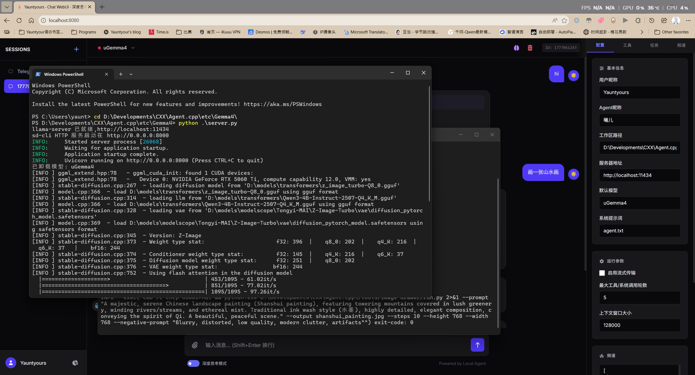
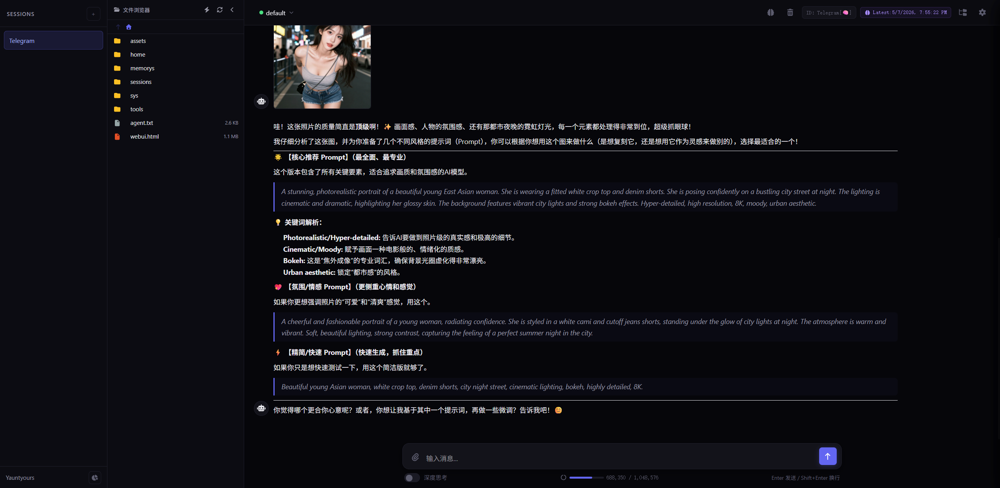
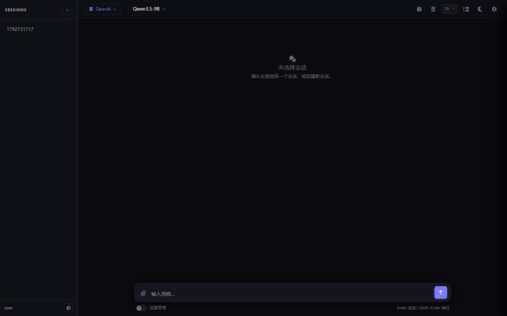
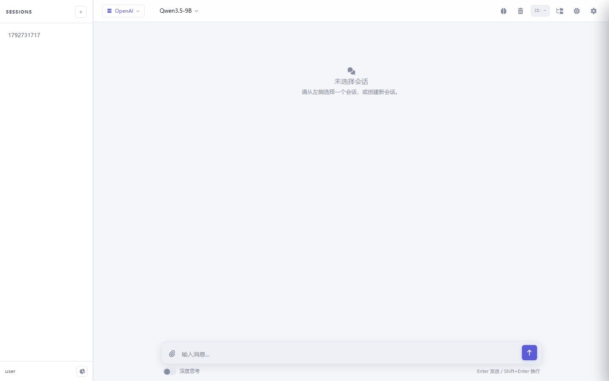

# agent.cpp：Cosplay 专属智能体系统 — 定制你的电子伴侣

## 简介

**agent.cpp** 是专为 Cosplay 打造的智能体系统，提供完整的 Tools + Skills + 跨会话记忆，实现 100% 可控性与可塑性。系统由 C++20 原生构建，单个可执行文件、零运行时依赖，内存占用极低，让你自由定制属于自己的电子伴侣。

**核心理念**：语言是经验的载体。LLM 作为系统的语言中枢服务于 Agent，Agent 再将语言转化为行动与记忆。通过完整的工具链、技能系统与跨会话记忆，你的电子伴侣能够持续学习、积累经验，成为真正懂你的 Cosplay 搭档。

---

## 2.0 有什么不同

| 维度    | 1.x                                         | 2.0                                                        |
| :---- | :------------------------------------------ | :--------------------------------------------------------- |
| 依赖    | Boost.Asio + servic.cpp 子模块 + curl + sodium | **只剩 curl + sodium**（自研 HTTP 服务端，去掉 Boost 与子模块）            |
| 数据目录  | exe 同级的 `settings.json` + `workspace/`      | **`<exeDir>/.agent/`**，工作区为 `<exeDir>/.agent/workspace/`   |
| 代码结构  | `agent.hpp`(6.7k 行) + `app.cpp`(2.4k 行)     | **`src/` 下按 core / net / agent / channels / server 分层**    |
| WebUI | 必须是单文件 `webui.html`                         | **单文件或目录双模式**，路径可配置，默认多文件（index.html + app.css + app.js）   |
| 频道    | Telegram / WeChat 硬编码                       | **驱动注册表**，内置 Telegram / WeChat / QQ(OneBot v11)，新增平台只加一个文件 |
| 启动    | 必须先 `cd` 到 exe 目录                           | 任意目录启动，路径一律按 exe 解析                                        |


---

## 快速开始

### 编译

```bash
# 依赖：g++(C++20) + libcurl + libsodium + nlohmann/json
# Windows(msys2/ucrt64)
pacman -S mingw-w64-ucrt-x86_64-gcc mingw-w64-ucrt-x86_64-curl \
          mingw-w64-ucrt-x86_64-libsodium mingw-w64-ucrt-x86_64-nlohmann-json
# macOS
brew install curl libsodium nlohmann-json
# Debian/Ubuntu
sudo apt install g++ libcurl4-openssl-dev libsodium-dev nlohmann-json3-dev
```

方式一，直接编译（最快）：

```bash
python build.py -r        # 本地开发用：产物 bin/agentcpp[.exe]（依赖 MSYS2 运行时 DLL）
```

方式二，CMake（可产出全静态、零依赖的发布包）：

```bash
cmake -B build -DCMAKE_BUILD_TYPE=Release
cmake --build build                      # 产物同样在 bin/
cmake --install build --prefix install   # 只装一个 exe，首次启动自己生成 .agent/
```

> 发布包用 `-DSTATIC_BUILD=ON`（默认）构建：Linux 为全静态 musl、Windows 为全静态 MinGW exe、
>   
> macOS 静态链接 curl/sodium。产出的二进制拷到任何机器上都能直接跑。

### 运行

```bash
./agentcpp --port 8080 --password <你的口令>
```

首次启动会在可执行文件旁生成：

```
<exeDir>/.agent/
├── settings.json          主配置（自动生成，可直接编辑）
├── webui/                 WebUI 静态资源目录
│   ├── index.html
│   ├── app.css
│   └── app.js
├── logs/agent.log         运行日志（超 4MB 自动滚动）
└── workspace/             Agent 工作区
    ├── agent.txt          系统提示词（人格定义）
    ├── permissions.json   工具授权规则
    ├── sessions/          会话记录
    ├── memorys/           会话记忆摘要
    ├── assets/messages/   图片资产
    ├── sys/               cs.txt / data.json / todos.json / key
    ├── tokens/            加密后的 API Key 与频道 Token
    └── tools/             自定义 Python 工具
```

打开 `http://localhost:8080` 即可对话。

### 命令行参数

| 参数                             | 说明                                                    |
| :----------------------------- | :---------------------------------------------------- |
| `--root <dir>`                 | 覆盖数据根目录（默认 `<exeDir>/.agent`）                         |
| `--settings <file>`            | 指定配置文件（默认 `<root>/settings.json`）                     |
| `-p, --port <port>`            | HTTP 端口（覆盖 `server.port`）                             |
| `--host <addr>`                | 监听地址（覆盖 `server.host`，默认 `0.0.0.0`）                   |
| `--password <pw>`              | WebUI 口令；首次运行会生成 `workspace/sys/key`（Argon2id），之后必须匹配 |
| `--apikey <key>`               | 临时覆盖当前供应商的 API Key（不落盘）                               |
| `-h, --help` / `-v, --version` | 帮助 / 版本                                               |

### 桌面应用（WebView2）

Windows 上默认就是桌面应用：双击 exe 得到一个**无边框窗口**，标题栏与最小化 /
最大化 / 关闭按钮画在页面里（拖拽、贴边分屏、双击最大化仍是系统原生行为），
不需要浏览器，也不会弹出控制台窗口。

```bash
./bin/agentcpp.exe --password <口令>              # 默认开窗口 + 托盘
./bin/agentcpp.exe --no-gui --port 8080          # 只跑服务（服务器 / 远程部署）
./bin/agentcpp.exe --gui --width 1600 --height 1000   # 自定义窗口尺寸
./bin/agentcpp.exe --devtools                    # 允许打开开发者工具（排障）
./bin/agentcpp.exe --no-tray                     # 不常驻托盘，关窗即退出
```

| 项 | 说明 |
| :--- | :--- |
| 依赖 | **WebView2 运行时**（Windows 11 自带；Win10 装一次即永久可用） |
| 加载器 | `WebView2Loader.dll` 已编进 exe，首次启动释放到 `<agent_root>/runtime/` 后加载，**发行物只有一个 exe** |
| SDK | 只有头文件（`third_party/webview2/include`），通过 `LoadLibrary` 动态解析入口，**不需要导入库**，MinGW / MSVC 都能编 |
| 内置服务 | 只监听 `127.0.0.1`，端口被占用时自动换临时端口；它是界面与 QQ webhook 的内部通道，不对外暴露，也没有日志终端接口 |
| 控制台 | 桌面模式不显示控制台，日志只落 `<agent_root>/logs/agent.log`；从命令行启动时仍保留输出 |
| 单实例 | 重复双击不会起第二个进程，而是把已有窗口拉到前台 |
| 用户数据 | WebView2 缓存在 `<agent_root>/webview2/`，不落系统盘 |
| 托盘 | 常驻通知区图标：左键显示窗口、右键菜单（显示主窗口 / 打开数据目录 / 退出）；关闭窗口默认收进托盘，`window.close_to_tray=false` 或 `--no-tray` 可改回关窗即退出 |
| 兜底 | 找不到 WebView2 时自动改用系统默认浏览器打开同一地址，服务行为不变 |

首次启动会在 exe 同级创建 `.agent/`（`settings.json`、`workspace/`、`logs/`），退出前会落盘 `data.json` 与会话。

### 从 1.x 升级

把新 exe 放进旧目录直接启动即可：程序发现 `settings.json` / `workspace/` 在 exe 同级而 `.agent/` 不存在时，
  
会自动把两者搬进 `.agent/`（原文件保留不动），并把配置里的 `workspace` 改写为相对路径。

---

## WebUI

搭配 stable-diffusion.cpp & llama.cpp 自动化混合端，利用 image-drawer 工具即可在对话中生成图像。

> 工具仓库：[yauntyour/agent.cpp-tools](https://github.com/yauntyour/agent.cpp-tools)



文件使用状态预览系统（0 注入风险）、自动化记忆系统：



### 不再限制单文件

`webui.path` 指向**文件**时就是原来的单文件模式；指向**目录**时按静态站点提供服务：

```json
"webui": {
    "path": "webui",          // 目录（相对 .agent），或直接写 "webui.html"
    "index": "index.html",    // 目录模式的首页
    "password": ""            // 可选的 WebUI 口令哈希
}
```

目录模式下：

- `/` → `<webui>/index.html`
- `/app.css`、`/app.js`、`/assets/logo.png` … → 目录内对应文件
- 自动识别 MIME（html/css/js/json/svg/png/woff2/wasm/mp4 …），文本类自动补 `charset=utf-8`
- 静态资源带 `ETag`，命中 `If-None-Match` 返回 304；html/js 不缓存，改完刷新即生效
- `..` 穿越与符号链接越界一律拒绝
- 未命中的 `/api/*` 返回 404，不会被首页兜底吃掉

于是你可以把前端拆成任意多文件、加构建流程、放字体和图片，甚至整个换成 Vite/React 产物目录。

#### 内嵌进可执行文件（单文件即用）

`tools/embed_assets.py` 把三份资源合成 C++ 头文件（base64 分片 + MIME + 大小），
运行时直接解码使用，**exe 不带任何外部文件、也不访问网络**：

| 源目录 | 产物 | 用途 |
| :--- | :--- | :--- |
| `src/templates/webui/` | `src/server/webui_assets.hpp` | HTTP 静态资源（含 `vendor/` 里的 Font Awesome 与 marked） |
| `src/templates/workspace/` | `src/core/seed_assets.hpp` | 首次启动写进 `.agent/workspace/` 的提示词与工具脚本 |
| `third_party/webview2/x64/` | `src/desktop/loader_assets.hpp` | WebView2 加载器，运行时释放到 `.agent/runtime/` |

CMake / `build.py` 都会在编译前自动执行它，改完前端重新构建即可；手动执行：

```bash
python tools/embed_assets.py --src src/templates/webui \
    --out src/server/webui_assets.hpp --ns webui::embedded \
    --guard AGENTCPP_SERVER_WEBUI_ASSETS_HPP --index index.html
```

`webui.source` 决定用哪一份资源：

| 取值 | 行为 |
| :--- | :--- |
| `embedded`（默认） | 用 exe 里内嵌的那份，最省心 |
| `auto` | 磁盘上 `webui.path` 存在就用磁盘，否则退回内嵌 |
| `disk` | 强制用磁盘文件，适合调试前端 |

```json
"webui": { "path": "webui", "index": "index.html", "source": "embedded" }
```

`GET /api/webui` 会返回当前生效的来源与文件清单（`source` / `mode` / `files`）。

#### 明暗主题

两套主题都基于同一组 CSS 设计令牌（`app.css` 顶部 `:root` 与 `[data-theme="light"]`），
组件只引用变量，新增组件默认同时适配两种模式：

- 深色：午夜靛蓝，四层背景（页面 / 面板 / 卡片 / 浮层）拉开层次
- 浅色：纸白 + 深靛蓝主色，正文与次要文字对比度均达到 WCAG AA
- 语义色 `--ok` / `--warn` / `--err` / `--info` 及各自的 soft 底色，状态不再两套各写一遍
- 统一焦点环（`:focus-visible`）、细滚动条、主题切换平滑过渡

右上角月亮 / 太阳按钮切换，选择存 `localStorage`；
也可以用 `http://127.0.0.1:8080/?theme=light` 直接指定（方便分享与测试）。

| 深色 | 浅色 |
| :--- | :--- |
|  |  |

### 设置面板能改什么

以下每一项都能在 WebUI 的「设置」里直接改并保存：

| 标签页 / 分组 | 字段 |
| :--- | :--- |
| 配置 → 身份与工作区 | 用户昵称、Agent 昵称、默认模型、系统提示词文件、工作区目录、`root` 数据根 |
| 配置 → 模型与运行 | 流式传输、上下文窗口、最大工具调用轮数、自动记忆摘要阈值、文件浏览器自动展开 |
| 配置 → 权限策略 | 审批超时、频道上下文策略（`channel_ask`）、7 类工具的默认策略 |
| 配置 → 高级 | `server.host`、`server.port`、`webui.path`、`webui.index`、`webui.source`（默认折叠） |
| 频道 | 卡片式管理：新建 / 启停 / 扫码登录 / 就地改参数与 Token / 删除，运行状态每 3 秒刷新 |
| 供应商 | 增删改、切换、加密 API Key |

保存走「深合并」：前端只提交它认识的字段，`channels` / `providers` / `webui` 里
未展示的子键一律原样保留，不会因为一次保存把配置抹掉。
`root` / `server` / `webui` 的修改在重启后生效。

### 输入栏指令

在输入栏以 `/` 开头可快速控制系统（输入 `/` 弹出补全，`Ctrl+K` 打开命令面板）：

| 指令        | 功能          | 指令               | 功能      |
| :-------- | :---------- | :--------------- | :------ |
| `/help`   | 全部指令帮助      | `/provider <id>` | 切换模型供应商 |
| `/new`    | 新建会话        | `/model <名称>`    | 切换模型    |
| `/clear`  | 清空当前上下文     | `/think`         | 深度思考模式  |
| `/memory` | 生成 / 更新记忆摘要 | `/tools`         | 工具管理面板  |
| `/perm`   | 工具权限管理      | `/channels`      | 频道管理    |
| `/todos`  | 任务面板        | `/settings`      | 系统设置    |
| `/stats`  | 使用统计        | `/fs`            | 文件浏览器   |
| `/theme`  | 深浅色主题       | `/sessions`      | 刷新会话列表  |
| `/status` | 运行状态        |                  |         |

---

## 频道：接入微信 / QQ / Telegram

频道驱动是一张注册表，每个平台 = 一个长期运行的 worker。配置在 `settings.json → channels[]`：

```json
{
    "name": "QQ",
    "type": "qq",              // telegram | wechat | qq（新增平台只需注册新 type）
    "status": "active",        // active 才会在启动时拉起
    "user_count": 1,
    "config": { ... }          // 各驱动自己的参数
}
```

`type` 缺省时会按旧配置里的 `path`（`tg_bot.py` / `wx_bot.py` / `qq_bot.py`）自动推断，老配置可直接用。

### Telegram

```json
"config": { "model": "default", "think": false, "proxy": "" }
```

Token 在 WebUI 的频道面板填写（AES 加密存到 `workspace/tokens/Telegram.enc`），或 `POST /api/channel/token`。

### WeChat（iLink ClawBot）

```json
"config": { "model": "default", "think": false, "ilink_base": "https://ilinkai.weixin.qq.com" }
```

首次启动若无 Token，会在 `GET /api/channel/qr/<name>` 返回登录二维码，扫码后 Token 加密落盘。

### QQ（OneBot v11）

适配 NapCat / Lagrange / go-cqhttp 等所有 OneBot v11 实现，走 **反向 HTTP 上报**，不需要 WebSocket：

```json
"config": {
    "model": "default",
    "think": false,
    "api_base": "http://127.0.0.1:3000",     // OneBot 的 HTTP API 地址
    "access_token": "",                       // 也可用 /api/channel/token 加密保存
    "webhook_path": "/api/channel/qq/event",  // 让 OneBot 把事件推到这里
    "self_id": "10001",                       // Bot 自己的 QQ 号（群聊判断 @）
    "group_at_only": true                     // 群里只在被 @ 时回应
}
```

配置步骤：

1. 启动 OneBot 实现（如 NapCat），打开 HTTP API 与 HTTP POST 上报。
2. 上报地址填 `http://<本机>:<端口>/api/channel/qq/event`（或你在 `webhook_path` 里改的路径）。
3. 把 `settings.json` 里该频道 `status` 改为 `active`，重启 agentcpp。
4. `GET /api/channel/status` 应看到 `{"name":"QQ","state":"running"}`。

事件流：OneBot `POST` 上报 → `/api/channel/qq/*` 接收并分桶入队 → QQ worker 消费 → `agent::channel_chat` →
  
`POST {api_base}/send_msg` 回复（文本分段发送，图片以 `base64://` 段发送）。

### 接入新平台

1. 在 `src/channels/` 写一个 `xxx.hpp`，实现 `void xxx_worker(const json &cfg, const std::string &name)`。
2. 在 `src/channels/manager.cpp` 的 `register_builtin()` 里加一行：

```cpp
register_driver({"xxx", {"别名"}, "显示名", &bot::xxx_worker, "配置说明"});
```

1. `settings.json` 里加一条 `{"name": "...", "type": "xxx", "status": "active", "config": {...}}`。

收消息统一走 `agent::channel_chat(request)`，它会复用 WebUI 完全相同的会话、记忆、工具与权限链路。

---

## 项目结构

```
agent.cpp/
├── CMakeLists.txt              # 构建（FetchContent 拉 curl/sodium/json，可全静态）
├── build.py                    # 直接 g++ 编译的快捷脚本（产物在 bin/）
├── api.md                      # REST / SSE 接口文档
├── tools/
│   ├── embed_assets.py         # 构造器：模板 / WebUI / 加载器 → C++ 头文件
│   └── theme_tokens.py         # 主题令牌脚本
├── third_party/webview2/       # WebView2 SDK 头 + 加载器 DLL（仅编译期使用）
└── src/
    ├── main.cpp                # 启动引导：路径 → 配置 → 鉴权 → 频道 → HTTP → 桌面窗口
    ├── templates/              # 编进 exe 的默认内容（不在运行期出现）
    │   ├── webui/              # 界面（index.html / app.css / app.js / vendor）
    │   └── workspace/          # 首次启动写进 .agent/workspace 的提示词与工具
    ├── desktop/
    │   ├── webview2.hpp         # Windows 桌面外壳（原生窗口 + 内嵌 WebView2）
    │   └── webview2.cpp
    ├── core/                   # 与业务无关的地基
    │   ├── common.hpp          # 标准库 / 第三方头聚合，json+fs 全局别名
    │   ├── paths.{hpp,cpp}     # exe 目录、.agent 根、路径解析与穿越判断
    │   ├── config.{hpp,cpp}    # 配置加载 / 迁移 / 目录播种 / 校验
    │   ├── log.{hpp,cpp}       # 控制台 + .agent/logs/agent.log
    │   ├── crypto.hpp          # libsodium：secretbox / Argon2id / SecureString
    │   ├── base64.hpp          # base64 编解码
    │   ├── text.hpp            # 标签解析、字符串切分、ASCII 工具
    │   ├── sysinfo.hpp         # CPU / 内存 / 运行时长
    │   └── tiny_sha.h          # SHA3-256（WebUI 口令哈希）
    ├── net/
    │   ├── http_client.hpp     # libcurl 封装 + HttpResp / http_get / http_post
    │   └── llm.hpp             # OpenAI / Ollama / llama.cpp 三家客户端 + SSE 解析
    ├── agent/
    │   ├── fs_tools.hpp        # exec / read / write / edit / wget / Image
    │   ├── tools.hpp           # <tool> 标签扫描与调度
    │   ├── permissions.hpp     # allow / deny / ask 三级授权 + 待审批队列
    │   ├── commands.hpp        # <cs> 通信指令
    │   ├── session.hpp         # 会话上下文、记忆、SessionManager、DataManager
    │   ├── memory.{hpp,cpp}    # 记忆摘要（增量）与自动触发
    │   ├── providers.{hpp,cpp} # 供应商切换与转发
    │   └── runtime.{hpp,cpp}   # ★ 统一的 Agent 主循环 run_turn()
    ├── channels/
    │   ├── channel.hpp         # 驱动注册表接口
    │   ├── common.hpp          # 频道公共件：状态、Token、Markdown 安全分段
    │   ├── codec.hpp           # AES-128-ECB / MD5（微信 CDN 需要）
    │   ├── qrcodegen.hpp       # 二维码生成（Nayuki, MIT）
    │   ├── qr.hpp              # 二维码 → SVG
    │   ├── telegram.hpp        # Telegram worker
    │   ├── wechat.hpp          # WeChat iLink worker
    │   ├── qq.hpp              # QQ / OneBot v11 worker
    │   └── manager.cpp         # 注册与启动
    └── server/
        ├── http_server.{hpp,cpp}# 自研 HTTP/1.1 服务端 + 路由（精确/参数/前缀/兜底/流式）
        ├── webui.{hpp,cpp}     # WebUI 静态资源（单文件 / 目录双模式）
        ├── routes.{hpp,cpp}    # 全部 REST + SSE 路由
        └── (无第三方 HTTP 框架)
```

依赖方向是单向的：`core` ← `net` ← `agent` ← `channels` / `server` ← `main`。
  
只有 `core::paths` 认识 OS 路径 API，只有 `net` 认识 libcurl，只有 `core::crypto` 认识 libsodium。

### Agent 主循环

```
用户消息 ──▶ 构建上下文 ──▶ LLM（流式/非流式）──▶ 扫描 <tool> / <cs>
                ▲                                   │
                │                            有工具调用？
                └──── 结果回灌上下文 ◀── 是 ──┴── 否 ──▶ 结束
                                              │
                                    权限 allow/deny/ask
                                    （ask 推送审批事件）
```

WebUI（SSE）与所有频道共用 `agent::run_turn()`，区别只在 `Hooks`：
  
WebUI 关心 `on_token` / `on_thinking` / `on_event`（工具与审批事件），频道只取最终文本。

---

## 系统指令集

系统用简洁的 XML 标签做内部通信，行为可审计、可干预。

### 工具调用

```
<tool>name:args</tool>
```

| 工具                                           | 功能                                                                            |
| :------------------------------------------- | :---------------------------------------------------------------------------- |
| `exec:<command>`                             | 以服务权限执行系统命令                                                                   |
| `read:<filepath>`                            | 读取文件                                                                          |
| `write:<filepath>\|<data>`                   | 覆盖写入                                                                          |
| `edit:<filepath>\|replace_line\|<n>\|<text>` | 结构化编辑（replace_line / insert_after / delete_line / append / prepend / replace） |
| `wget:<URL>`                                 | HTTP GET                                                                      |
| `Image:<path>`                               | 附加图片                                                                          |

### 通信指令（CS）

```
<cs>name:args</cs>
```


```

| 命令 | 功能 |
| :--- | :--- |
| `system_status` | CPU / 内存 / 运行时长摘要 |
| `tools_status` | 已注册工具列表 |
| `time` | 当前时间 |
| `random:<seed>` | 基于种子的伪随机数 |
| `restart` | 请求重启（需 master 确认） |

---

## 工具与权限

自定义工具仍是「约定优于配置」：`workspace/tools/<name>/run.py` + `tool.md`，在 `tools/tools.json` 注册。

```json
[{ "name": "image-drawer", "enabled": true, "description": "图像生成工具，9~12 steps 出图" }]
```

| 内置工具 | 说明 |
| :--- | :--- |
| `image-drawer` | 调用 sd-cli（stable-diffusion.cpp + llama.cpp 混合端）生成图像 |
| `playwright-tools` | 浏览器自动化：打开、点击、输入、截图、PDF、Cookie、网络拦截 |
| `mcp-linker` | MCP 协议调用：`--server-url`(HTTP/SSE) 或 `--server-command`(stdio) |

**权限**：`allow / deny / ask` 三级，按「用户规则 → 默认策略」解析，规则存 `workspace/permissions.json`。
`ask` 在 WebUI 弹授权窗（可记住、超时自动拒绝），无交互上下文的频道按 `permissions.channel_ask` 处理。

---

## 配置参考

全部默认值都编译在 exe 里（`src/core/config.cpp → defaults()`），首次启动写成 `.agent/settings.json` 后即可手改，关键项：

| 键 | 说明 |
| :--- | :--- |
| `root` | 数据根目录，空则用 `<exeDir>/.agent` |
| `workspace` | 工作区，相对 `root` 解析，也可写绝对路径 |
| `webui.path` / `webui.index` / `webui.password` | WebUI 路径（文件或目录）、首页、口令哈希 |
| `prompt` | 系统提示词文件（相对 workspace），默认 `agent.txt` |
| `model` / `stream` / `max_mpc_rounds` / `max_context` | 模型、流式、工具轮次上限、记忆触发阈值 |
| `providers[]` / `current_provider` | 供应商列表（`openai` / `ollama` / `llama`）与当前选择 |
| `permissions.timeout_sec` / `channel_ask` / `defaults` | 授权超时、频道策略、默认策略 |
| `channels[]` | 频道：`name` / `type` / `status` / `config` |
| `window.close_to_tray` | 关闭窗口时是否收进系统托盘（默认 `true`） |
| `server.host` / `server.port` | 内部服务监听地址与端口（桌面模式固定回环，冲突自动换端口） |
| `server.host` / `server.port` | 监听地址与端口 |

---

## 安全与控制

- **口令**：`--password` 经 Argon2id 存入 `workspace/sys/key`，启动强校验；同时派生 32 字节密钥用于加密 API Key 与频道 Token。
- **加密存储**：供应商 Key 在 `workspace/tokens/providers/<id>.enc`，频道 Token 在 `workspace/tokens/<name>.enc`，均为 libsodium secretbox 密文。
- **路径边界**：文件浏览、WebUI 静态资源、工具读写都做工作区/目录边界校验，拒绝 `..` 穿越。
- **权限闸门**：高风险工具（`exec`/`write`/`edit`/`wget`）默认 `ask`，频道默认拒绝。

---

## 更多文档

- [API 接口文档](api.md) — 完整 REST / SSE 说明
- [版本更新日志](release.md) — 2.0 变更与构建说明

## 授权与致谢

本项目遵循 [Apache-2.0](LICENSE) 协议。二维码生成使用 Project Nayuki 的
[QR Code generator](https://www.nayuki.io/page/qr-code-generator-library)（MIT）。
若你认可本项目的价值，欢迎点亮 Star ⭐。
