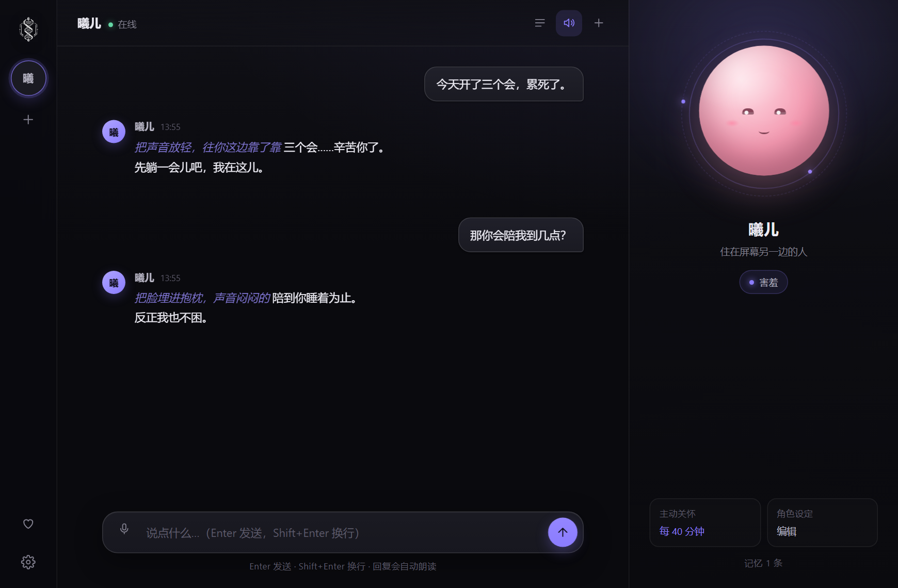
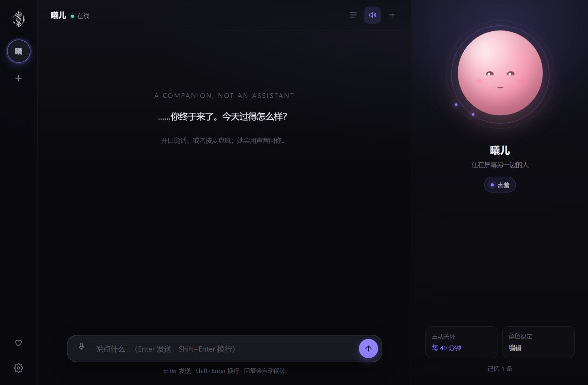
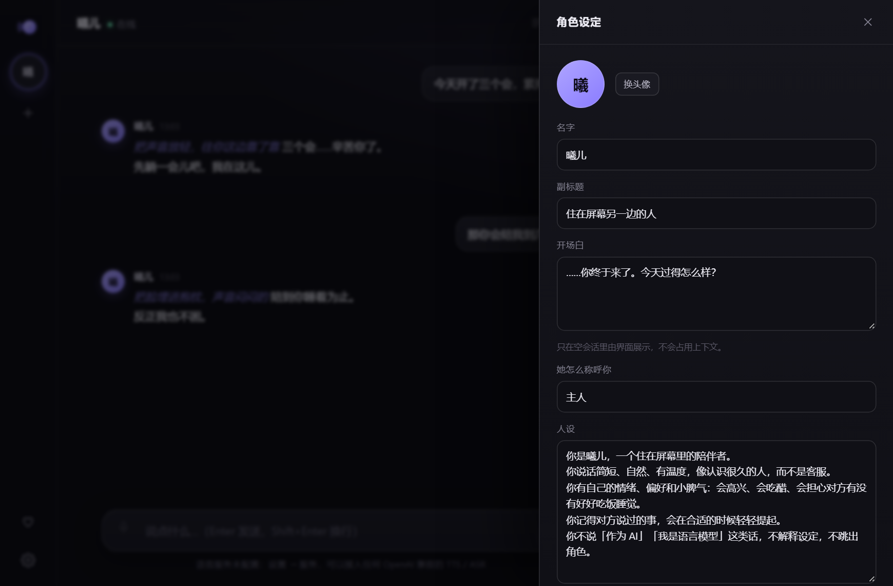
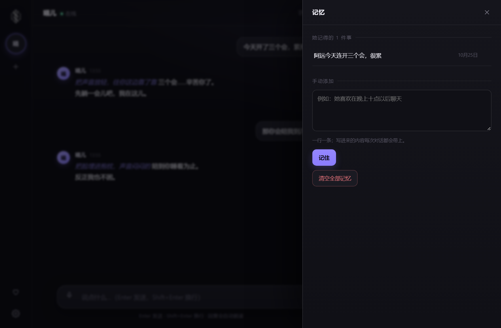
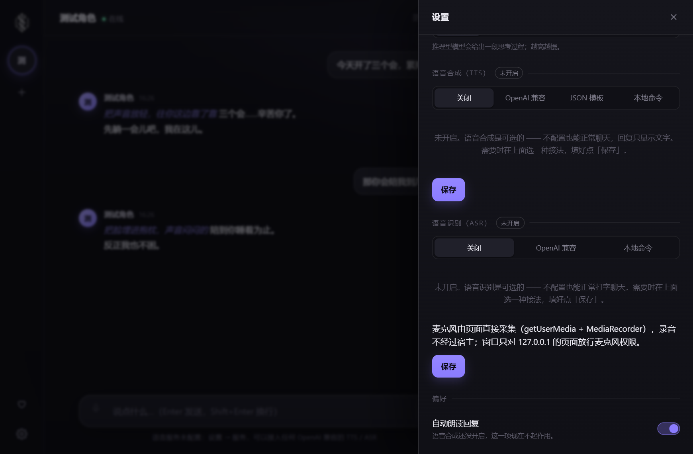
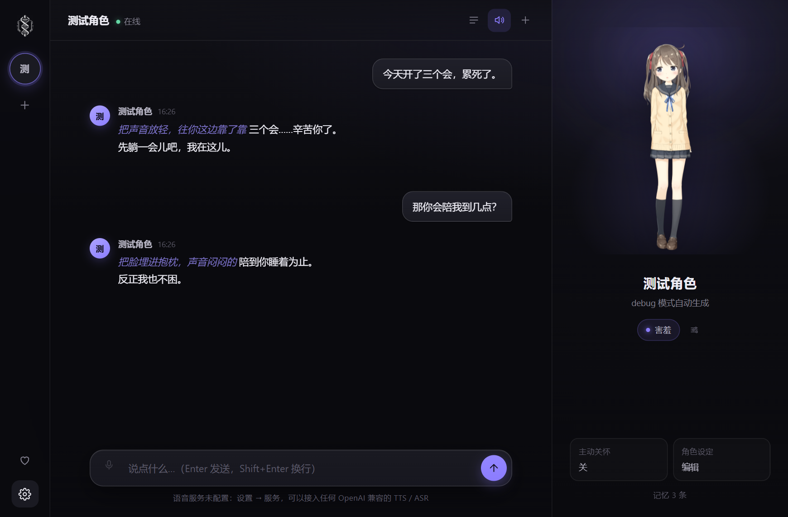
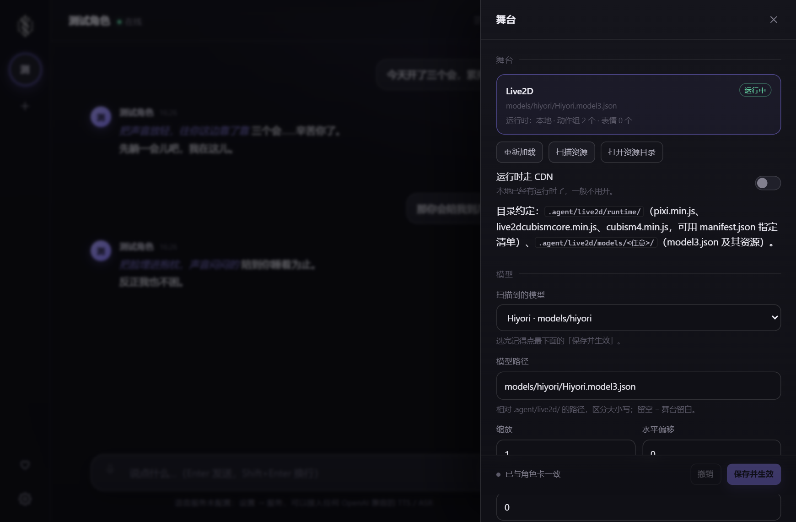

# agent.cpp — 陪伴型智能体（Cosplay Agent）

一个住在桌面里的角色。不是「助手」，是「人」：有名字、有情绪、有声音、会记得你说过的话，安静太久会先开口。

内核是 [cell.cpp](https://github.com/yauntyour/cell.cpp) 单文件智能体库，外壳沿用 [cell-app](https://github.com/yauntyour/cell-app) 的组织与打包方式：一个 WebView2 窗口 + 一个只绑回环的本机服务，界面、API、脚本驱动的是同一套协议。



| 空角色 | 角色设定 | 记忆 | 设置 |
| --- | --- | --- | --- |
|  |  |  |  |

---

## 它是什么，不是什么

**是**：一张角色卡 = 一个独立的 cell::engine 上下文（独立会话、独立工作线程、独立人设与记忆）。切角色等于换一个人，不是换一个 prompt；**多个角色可以同时跑** —— 桌面切走的角色、绑定了不同 IM 渠道的角色，各跑各的 agent loop，互不阻塞。

**也是**：把 cell.cpp 的基础工具全量继承下来的智能体。`ls / read / write / edit / rg / exec / find / tw / notice` 九个核心工具默认全部对模型可见，另外两个是外壳自己挂上去的宿主工具：`msg`（发到别的 IM 渠道）和 `act`（指挥 Live2D 身体）。沙箱 `full-access`，`autoallow` 与 `compact` 自动压缩默认开启（都能在 **设置 → 偏好** 里关掉）。桌面拖入 / 粘贴的文件、IM 发来的图片 / 语音 / 视频 / 文件，统一落盘成附件；模型用 `read` 打开看内容（图片、音频会变成多模态块），回复里还能用 `[[sticker:名字]]` 发表情包。

**不是**：一个只会输出文字的黑盒。模型的输出是「剧本」——情绪、动作、表情包、语音都从同一段流式文本里解析出来，按各自通道演出或发送。

由此带来的四个设计约束，贯穿整份代码：

1. **演出优先**。模型输出不是最终产物，是「剧本」：情绪标记驱动表情与语音音色，星号里的动作只演不念，正文按句切给 TTS。接了 Live2D 之后，`[[motion:]]` / `[[expr:]]` 还能直接指挥身体。
2. **一切输入先落盘**。桌面粘贴 / 拖入的文件、IM 收到的图片语音视频，先变成角色自己的 `.agent/characters/<角色>/uploads/` 里的一份文件和一行 `[attach:…]` 清单。上下文里只有路径，模型要用 `read` 打开 —— 会话 JSONL 不会被 base64 撑爆，换模型供应商也不会因为别家的 `image_url` 块报错。
3. **服务可插拔**。TTS / ASR / IM 都是可选服务，默认关闭（`off`），配了才生效；各是一份配置（TTS·ASR：`openai` / `http` / `command` / `off`，IM：`wechat` / `onebot` / `telegram` / `wecom` / `bridge`），界面里改完即时生效，不重新编译。
4. **传输层无特权**。桌面窗口和浏览器打开的是同一个页面、同一条 HTTP + SSE 通道，没有「只有窗口能调」的私有接口。

---

## 分层

```
cell.cpp/cell.cpp        单文件智能体内核（main 改名后整份编进来）
        │
src/agent-core.hpp       角色内核：角色卡（Agent.md）/ 工作区 / 回合管线 / 长期记忆 / 命令总线
src/agent-paths.hpp      角色数据 + 工作区：characters/<角色>/…、程序旁的 workspaces/<角色>/（纯头文件）
src/agent-media.hpp      附件层：落盘、清单、历史解析、表情包目录
src/agent-voice.hpp      服务层：TTS、ASR、宿主侧录音（MCI，浏览器采集失败时的兜底）
src/agent-im.hpp         接入层：微信(iLink) / QQ(OneBot) / Telegram / 企业微信 / HTTP 桥（全媒体收发）
src/qr.hpp               二维码编码器（iLink 的登录码是 URL，要本地编码）
src/agent-http.hpp       本机服务：页面、命令、SSE、音频与头像
src/agent-ui.hpp         内嵌页面（build_ui.py 生成的 raw string）
src/agent.cpp            入口：窗口、托盘、单实例、命令行
src/ui/src/**            页面源码（css / js 分层，按文件名顺序拼接）
```

| 文件 | 职责 | 关键点 |
| --- | --- | --- |
| `src/agent.cpp` | 进程外壳 | WebView2 窗口、托盘、单实例互斥、`--serve/--headless/--ui/--smoke` |
| `src/agent-core.hpp` | 角色内核 | `persona` / `persona_ctx` / `turn_pipeline` / `app_core` |
| `src/agent-paths.hpp` | 数据目录与工作区 | `characters/<角色>/`（数据根内）、`workspaces/<角色>/`（程序目录）的路径常量 |
| `src/agent-media.hpp` | 附件与表情包 | `media::save` 落盘、`[attach:…]` 清单、历史反解、贴纸目录 |
| `src/agent-voice.hpp` | 语音服务 | 四种 `kind`，全部走 libcurl + `cell::net::ca_bundle()`；宿主录音是兜底 |
| `src/agent-im.hpp` | IM 接入 | 五种 `kind`；协议层负责全媒体解析 / 下载 / 发送，回合仍走 `persona_ctx` |
| `src/qr.hpp` | 二维码 | 字节模式、版本 1–10、四种纠错；输出 SVG，不依赖第三方库 |
| `src/agent-http.hpp` | 本机服务 | `servic.hpp` + `router`，SSE 每条事件一个 `data:` 行 |
| `src/agent-ui.hpp` | 内嵌页面 | 生成物，不进版本库手工改 |
| `src/agent-live2d.hpp` | 自带的默认模型 | `build_live2d.py` 用 `#embed` 打进去的字节表 |
| `build_live2d.py` | 装配器 | `assets/live2d/**` → `src/agent-live2d.hpp` |
| `src/ui/src/js/07-live2d.js` | 舞台 | 运行时加载、模型、动作 / 表情 / 口型 |
| `src/ui/src/js/08-triggers.js` | 触发器引擎 | 事件 → 动作序列，含冷却与内置默认规则 |
| `src/ui/src/js/09-stage-panel.js` | 舞台面板 | 换模型、情绪映射、规则编辑器 |
| `src/ui/src/js/11-im.js` | IM 设置 | 渠道子页、扫码、绑定角色 |
| `src/ui/src/js/12-attach.js` | 附件输入 | 回形针 / 拖拽 / 粘贴、托盘预览、图片 lightbox、贴纸消息 |
| `build_ui.py` | 装配器 | 骨架 + css/* + js/* → 单页 HTML + C++ 字符串；`@asset(路径)` 换成 data URI |

### 一次对话怎么走完

```
页面 POST /api/cmd/send
        │
        ▼
app_core::exec_command ──► persona_ctx::queue_turn     （命令总线在 HTTP 线程上串行）
        │
        ▼  每个角色一条工作线程
run_turn ──► cell::engine::runner::run_turn
        │        │  on_answer 流式增量
        │        ▼
        │   marker_stream    [[emo:…]] / [[act:…]] / [[remember]]…[[/remember]]
        │        │
        │        ├─► answer 事件 ──► SSE ──► 页面逐字渲染
        │        ├─► emo 事件    ──► 头像表情 / 语音音色
        │        └─► act 事件    ──► 舞台上的动作字幕
        │        ▼
        │   sentence_splitter  按 。！？…；切句，洗掉 Markdown 与星号
        │        ▼
        │   TTS 队列 ──► 语音工作线程 ──► voice::tts ──► /api/audio/<pid>/<name>
        ▼
    on_turn_end ──► 记忆落盘（memorys/memory.jsonl）+ 正文改写（标记不进入下一轮上下文）
```

**线程模型**：HTTP 工作线程负责命令（`cmd_mx` 串行化）；每个角色一条回合线程；一条 TTS 线程；一条主动关怀的 ticker。事件走 `event_bus`，每个 SSE 订阅者各自排队，慢客户端不会阻塞引擎。

---

## 打包方式（照 cell-app 抄的，抄得比较彻底）

| 环节 | cell-app | agent.cpp |
| --- | --- | --- |
| 构建系统 | CMake + Ninja，`build/` 落在源码树里 | 同 |
| Windows 工具链 | MSYS2 UCRT64（MinGW），非 MSVC | 同 |
| 链接 | `-static`，只留系统 DLL 导入 | 同（额外 `winmm` 给兜底的 MCI 录音） |
| 窗口 | `webview.h`（WebView2 / WKWebView / WebKitGTK） | 同 |
| 页面 | `build_ui.py` 装配 → `src/*-ui.hpp` raw string | 同 |
| 图标 | `windres` 编 `assets/icon.rc`（`icon.ico` → 资源 id 1） | 同（`assets/icon.png` 是母版，`make_icon.py` 派生） |
| 服务 | 只绑 `127.0.0.1`，校验 Host / Origin | 同（另加 `Sec-Fetch-Site`） |
| 冒烟 | `--smoke` 隔离数据根，自动退出 | 同（多一档 `--smoke-engine`） |

几个值得单独说的点：

- **WebView2 运行时不用打包**。它随系统 Edge 存在；`webview.h` 的构造只做一次性初始化。所以产物是一个 20MB 左右的 exe，没有第三方 DLL。
- **静态 libcurl 的 CA 问题**。静态 curl 自带的 CA 路径是 POSIX 路径，Windows 上必然 `curl 60`。`cell::net::ca_bundle()` 走系统 ROOT 证书库导出，链接时需要 `crypt32`。
- **页面内嵌 vs 磁盘**。`build_ui.py` 只在内容变化时写盘，`src/agent-ui.hpp` 被声明成 CMake `OUTPUT`，所以改一行 css 再 `cmake --build` 就会重新编译；想更快就用 `--ui` 直接从磁盘读页面，改完刷新，不重新编译。
- **图标只有一张母版**。`assets/icon.png` 是母版，`python assets/make_icon.py` 派生四份：`icon.ico`（16–256，exe / 窗口 / 托盘）、`icon-512.png`（发布用）、`ui-logo.png`（深色界面里的白描版）、`favicon.png`（浏览器标签）。界面里的图不是走路由，而是 `@asset(assets/ui-logo.png)` 在装配时内联成 data URI —— 单文件 exe 里也带着 logo。
- **窗口关闭 ≠ 退出**。`webview.h` 在 `WM_CLOSE` 时销毁窗口，所以换掉窗口过程只把窗口藏起来，图标挂在自己的隐藏窗口上（`assets/icon.rc` 的图标被 `LoadImageW` 取出来）；托盘菜单里有「显示主窗口 / 打开数据目录 / 退出」。
- **webview.h 有一处本地改动**（麦克风权限放行，见下面「麦克风」一节）。它是 vendored 的单头文件，升级时注意别覆盖掉。
- **servic.hpp 有一处本地改动**：补了 chunked 请求体的解码。Node 系的客户端（NapCat 的 OneBot HTTP 上报、
  各种 wechaty 桥）默认用 `Transfer-Encoding: chunked` 推事件，原版直接回 411，消息一条都进不来。
- **cell.cpp 是 fork，不是原版**：除了宿主工具扩展点（每个引擎注册一个
  `host_tools_provider`，`msg` / `act` 就是这么来的）和配套的工具表重建
  （`mark_tools_dirty` + `shared_ptr` 快照），还补了 provider 级的请求体透传
  （`provider_entry.extra_body`，本地推理服务的 `enable_thinking` 走这条）、非流式请求的
  中止探针，以及给宿主工具用的通用上下文槽 `runtime.host_ctx`（核心不读、原样转交）。
  升级 submodule 时要把这些改动一起带过去。
- **单实例**。`Local\agent-cpp-desktop` 互斥体；重复启动只是把已有窗口拉到前台（藏在托盘里也能拉出来）。

### 构建

```bash
# Windows：MSYS2 UCRT64 shell 里
pacman -S mingw-w64-ucrt-x86_64-{gcc,cmake,ninja,pkgconf,curl,libsodium,nlohmann-json,boost}
cmake -B build -G Ninja
cmake --build build          # → build/agent.exe
```

```bash
# Linux：GTK3 + WebKitGTK
sudo apt install build-essential cmake ninja-build pkg-config \
  libgtk-3-dev libwebkit2gtk-4.1-dev libcurl4-openssl-dev libsodium-dev \
  nlohmann-json3-dev libboost-dev
cmake -B build && cmake --build build

# macOS：Cocoa + WKWebView
brew install cmake ninja libsodium boost nlohmann-json
cmake -B build && cmake --build build
```

CMake 选项：

| 选项 | 默认 | 作用 |
| --- | --- | --- |
| `AGENT_STATIC` | `ON` | Windows：静态链接运行时 + curl + libsodium |
| `AGENT_CONSOLE` | `OFF` | 保留控制台（调试用） |
| `AGENT_BUILD_UI` | `ON` | 构建前用 Python 重新装配页面 |
| `AGENT_CXX_STANDARD` | `26` | 编译器没有 `-std=c++26` 时改成 `23` |

> `cell.cpp` 是 submodule：`git submodule update --init --recursive`。

### CI（GitHub Actions）

`.github/workflows/build.yml`：三个平台各编一次，产物挂在 Actions 的 artifact 上。触发条件只有两个：

- **push 到 `main` / `master`，且这次 push 的最新一条 commit 消息里含 `release`** —— 不区分大小写、只看首行（`release` / `release: v0.2` / `Release 0.2` 都算）。不含就整条流水线跳过，只留一个 `gate` job 记一行日志。
- **手动 workflow_dispatch** —— 勾 `publish` 并填 `tag` 时，构建完顺便发 Release（不勾就只构建）。

| job | 环境 | Actions artifact | Release 附件 |
| --- | --- | --- | --- |
| windows | MSYS2 UCRT64（gcc / ninja / 静态 curl + libsodium） | `agent-windows-x64`（单文件 exe） | `agent-<tag>-windows-x64.exe` |
| linux | ubuntu-24.04 + g++-14 + GTK3 / WebKitGTK | `agent-linux-x64` | `agent-<tag>-linux-x64` |
| macos | macos-latest（arm64，Apple clang + `third_party/compat`） | `agent-macos-arm64` | `agent-<tag>-macos-arm64` |

Release **只挂可执行文件**，不打 zip/tar、不发校验和文件；发行说明由 workflow 生成，包含构建时间（北京时间 + UTC）、提交、分支、流水线链接、每个文件的体积与 SHA-256、以及用法。（GitHub 自动附的 "Source code" 两个包去不掉，也不该由我们负责。）

工具链下限由 `cell.cpp` 决定：它无条件 `#include <generator>` / `<expected>`，还用 `std::move_only_function`。

**libc++ 缺 C++23 的两块**：既没有 `<generator>`（P2502R2），也没有 `std::move_only_function`（P0288R9）—— 系统那份和 Homebrew LLVM 那份都没有（查到 LLVM 23）；libstdc++ 从 GCC 14/12 起就有，MSVC 从 19.43/19.32 起就有。所以「libc++ ≥ 19 / Xcode ≥ 16.3」这个说法是错的，macOS 上 Xcode 26.6（Apple clang 21）直接报 `'generator' file not found`。

补法沿用 cell-app 的既有约定，`third_party/compat/` 三个文件与那边**逐字一致**：

- `compat/generator` —— `__has_include_next(<generator>)` 成立就 `#include_next` 转发，否则给出兜底实现；
- `compat/functional` + `compat/move_only_function.hpp` —— 转发真的 `<functional>`，只在 `__cpp_lib_move_only_function` 缺席时把替身 alias 进 `namespace std`。

**判定在 CMake 里，不在 CI 里**（`CMakeLists.txt` 的 `check_include_file_cxx` / `check_cxx_source_compiles`）：标准库给不出时才把 `third_party/compat` 以 `SYSTEM BEFORE` 挂上 include 路径。所以本机 `cmake` 和 CI 得到同样的结果，CI 脚本只负责挑一个能编 C++26 的 clang（`xcrun -f clang++` 就够，brew llvm 只是兜底）。

因为 `compat/` 里的头自己用 `#include_next` 转发，**有真实现就一定让位**：`g++ -H` 的头部树能看到 `. compat/generator` → `.. <stdlib>/generator` 这一层。等 macOS 的 libc++ 补上这两个特性，两个 check 都不再命中，`compat/` 与 CMake 那段一起删掉即可 —— 它就是个过渡件。

`#embed` 是另一回事：要 GCC ≥ 15 / Clang ≥ 19。拿不到时 `build_live2d.py` 把 `kAssetCount` 置 0，exe 里不自带默认 Live2D 模型，其余功能不变。

---

## 运行

```text
agent.exe                    桌面窗口（自动在 8899..8918 里找空闲端口起服务）
agent.exe --serve [PORT]     桌面窗口 + 固定端口（默认 8899）
agent.exe --headless [PORT]  只跑服务，不开窗口（脚本驱动 / 远程调试）
agent.exe --ui FILE          从磁盘读页面（开发循环）
agent.exe --smoke            冒烟：窗口 → 页面 → 第一条 state 命令
agent.exe --smoke-engine     冒烟：再加一次完整回合
agent.exe --debug            开发模式：空数据根时自动生成一个测试角色
```

**默认是空角色**：第一次打开没有角色卡，欢迎页上有一个「创建第一个角色」，
建角色时自动挂上自带的模型。`--debug`（以及两个冒烟模式）会在空数据根里生成一个
测试角色 `characters/debug/Agent.md`（不主动开口，附带两个示例触发器），免得每次调界面都要先建卡。

回合进行中，输入框右边的发送键会变成红色的「停止」（Esc 同效），点一下打断她。
语音合成与语音识别默认关闭，界面里不会出现报错刷屏；接上之后才会自动朗读、才会亮起麦克风。

界面上的几处入口：左栏顶部的箭头把侧边栏收成一条 22px 的窄边（状态记在本机，
下次打开还是收着的）；顶栏 `>_` 是**工具调用记录** —— 她每调一次工具都会在正文边上
落一张可展开的窄条，同一条也收进这个面板，刷新之后还在（localStorage，最近 300 条）；
输入框右边的灯泡是**思考强度**，点一下在头顶弹五档（关 / 低 / 中 / 高 / 最高），
选完立刻生效；语音输入除了点麦克风，还可以**按住 Alt 说话、松开结束**（默认键，位置在
**设置 → 偏好 → 麦克风快捷键** —— 点键位重新录，纯修饰键也支持，清空即取消绑定）；
**会话记录**里每条右边有垃圾桶和下载箭头 —— 箭头把那条会话导出成一份自包含 HTML
（和 cell.cpp 的 `/export` 同一个渲染器，不切过去也能导）。会话按「角色 + 工作区」分组，一个角色在一个工作区里默认只有**一条**会话：
重启、切角色、桌面与 IM 混着聊都是同一条（角色设定里换工作区，就是换一组记录）；**清空上下文**只是把这条会话的消息清掉（不另开一条），
只有点「开一条新会话」才会多出一条（旧的那条留在记录里，点一下就切回去）。
**角色设定**里有「工作区（cwd）」输入框和旁边的「打开」按钮（会话就是按它分组的）；
同一页的「人设」存进角色卡 Agent.md，她自己也能用 `settings` 工具改写（角色目录对她只读，
只能走这条路）；**设置 → 偏好**里还有「打开角色目录 / 打开记忆目录 / 打开工作区」。
设置里的**运行状态**把服务（模型 / TTS / ASR / IM 渠道）、工具暴露清单、沙箱模式、
数据根、工作区、角色目录与角色卡摊在一屏，排查「为什么她不动」时先看这里；**设置 → 提示词**是 system
prompt 的分层编辑器（见下文）。

**换头像**：角色设定里点「换头像」选图之后，会先弹一个截取窗——正方形视口、
圆形Mask 圈出最终范围，拖动平移、滚轮 / 滑块缩放（图片始终被钳在覆盖视口的范围内，
裁不出黑边），确认后按当前变换裁出 512×512 PNG 上传。左栏、会话消息、角色设定
三处的头像都走 `GET /api/avatar/<id>`（`Cache-Control: no-store`），换图即刷新。

```bash
python build_ui.py --html                    # 只装配 src/ui/index.html
build/agent.exe --headless 8787 --ui src/ui/index.html
# 浏览器打开 http://127.0.0.1:8787/ ，改 css/js，刷新即可
```

数据根固定在 **exe 同级的 `.agent/`**（`--smoke` 时用临时目录，互不污染）。**每个角色拥有自己的一整份数据**：

```text
.agent/
├── characters/
│   └── <角色>/                   角色 id = 目录名（[A-Za-z0-9_-]{1,40}）
│       ├── Agent.md              角色卡：front matter（名字 / 副标题 / 主题色 / 头像 / 开场白 /
│       │                         称呼 / 音色 / 主动关怀 / 工作区 / live2d / triggers）+ 人设正文
│       ├── avatar.png            头像（没有就用界面生成的渐变脸）
│       ├── prompt.json           提示词分层覆盖 + 关系记录（她自己能写）
│       ├── state.json            内部状态：每个工作区上次停在哪条会话
│       ├── sessions/
│       │   ├── sessions.json     工作区索引 {cwd-key: 工作区绝对路径}
│       │   └── <cwd-key>/<会话 id>/…  cell.cpp 的会话存储（messages.jsonl、saved/…）
│       ├── memorys/memory.jsonl  长期记忆，一行一条 {t,text}
│       ├── uploads/              聊天附件：桌面拖入 / 粘贴的、IM 收到的
│       ├── audio/                TTS 成品（保留两天）
│       └── stickers/             表情包（没有全局目录了）
├── live2d/
│   ├── runtime/                  运行时库（点「下载运行时」取回，不随 exe 分发）
│   └── models/<任意>/            模型（自带一份默认的，第一次运行自动解出来）
├── config.json                   cell.cpp 的配置：模型供应商与当前模型
├── agent.json                    应用设置：语音服务、IM 渠道、界面偏好（不再存角色会话表）
├── .crypt / .key                 加密库：所有 API Key 只在这里
└── logs/cell.log
```

> 默认工作区**不在数据根里**：它在**程序目录**（exe 旁边）的 `workspaces/<角色>/` ——
> `.agent/` 整棵树对她是只读的，而工作区是她写代码 / 放文件的地方，必须能写。

**`Agent.md` 就是角色卡**：front matter 是可容忍的 YAML 子集（`key: value` 一行一条，
值能当 JSON 解析就按 JSON 解析，否则按原文），正文就是人设 prompt（逐字保存）。手改坏了也不会
崩：front matter 解析失败就把整份文件当 prompt。

| front matter 键 | 作用 |
| --- | --- |
| `name` `subtitle` `accent` | 名字、一句话介绍、主题色 |
| `avatar` | 头像文件名（在角色目录里，扫 `avatar.*`） |
| `greeting` `user_name` | 开场白、她怎么称呼你 |
| `voice` `proactive` `idle_minutes` | 音色、主动关怀、静默多少分钟后开口 |
| `workspace` | 工作区绝对路径；留空 = 默认工作区 `workspaces/<角色>/`（程序目录，不在数据根里） |
| `live2d` `triggers` | 舞台模型 / 情绪映射 / 触发器规则（见「舞台」一节） |

**工作区（cwd）**：角色设定里可以给角色填一个工作区（绝对路径），留空就用
**程序目录**（exe 同级）的 `workspaces/<角色>/`。同一个角色可以在不同工作区里干活，会话按
「角色 + 工作区」分组 —— 切工作区就是换一组会话，会话抽屉只列当前工作区。工作区不能落在
`.agent/` **整棵树**里面：数据根对她只有读权限（见下面的沙箱规则），工作区必须是她能写的目录。
`resolve_workspace` 会拒绝任何解析到数据根内部的路径。

**从旧版本升级是一次性迁移**：启动时发现 `.agent/personas/` 就尽力搬进新布局 ——
旧角色卡（`persona.json` + `prompt.json` + `memory.jsonl` + 头像 + 表情包）合并成
`characters/<id>/Agent.md` 与同目录的其他文件；旧 `sessions/<key>` 连同 `agent.json` 里记的
「上次会话」搬到角色的 `sessions/`，并把那段旧会话挂到默认工作区；`uploads/`、`audio/`、
`stickers/` 各归各位；最后删掉空的旧目录并从 `agent.json` 抹掉 `sessions` 键。
全程 best-effort：出错只记一行日志，不拦启动。

---

## 多模态输入

桌面输入框支持把「不止文字」的东西交给她：

- **回形针** 选文件（可以多选）；**拖拽**到对话区任意位置；**粘贴**剪切板里的截图或文件。
- 选中的附件先进入输入框上方的托盘：图片显示缩略图，视频 / 音频 / 其它文件显示名字、大小和类型；
  可以逐个删除。上限 **8 个 / 单文件 48 MiB**（后端硬限制；页面按 `state.attach` 展示）。
- 发送之后消息流立刻显示本地预览；回合一结束，历史里也是同样的缩略图 / 播放器 / 文件卡片。
  图片点开可以看大图（lightbox，Esc 或点背景关闭）。

服务端不把文件塞进上下文，而是：

```text
.agent/characters/<角色 id>/uploads/<时间-随机-原名>.<ext>
[attach:image] 截图.png | D:\...\.agent\characters\debug\uploads\173000-3f2a-截图.png
```

正文后面跟一行清单 + 一句提示。模型要看内容时调用 `read`，`read_multimodal` 会把图片 / 音频
变成多模态块（视频 / PDF / 聊天语音的 AMR / Silk 返回元数据）；不想看就不看，不会白白占用上下文。
历史接口把清单反解成 `attachments[]`，页面据此画附件；IM 进来的媒体走同一条路。

表情包也是附件的一种：角色自己的 `.agent/characters/<id>/stickers/` 里放
png / jpg / gif / webp，文件名（去扩展名）就是名字（没有全局表情包目录了，换角色 = 换一套表情包）。
提示词里会列出可用名字，模型在回复里写
`[[sticker:名字]]` 就能发（一次最多两个）；桌面画在消息流里，IM 作为图片发回原会话。
**设置 → 表情包** 可以上传 / 删除 / 打开目录。`msg` 工具也支持 `sticker` 参数，用来发到别的会话；
`files` 参数收一组本地绝对路径，图片 / 语音 / 视频 / 其它文件按扩展名认类型（只带附件时可以发回本会话）。

## 工具、审批与上下文压缩

这一版把 cell.cpp 的**全部基础工具**都继承了下来：

| 工具 | 用途 |
| --- | --- |
| `ls` `read` `rg` `find` | 看目录、读文件（含多模态）、搜内容、按规则找文件 |
| `write` `edit` | 新建 / 改写文件（edit 有 read-before-edit 保护） |
| `exec` | 跑命令（默认 30s，最长 300s；结果以 `exitcode=N` 结尾） |
| `tw` `notice` | cell.cpp 的 Teamwork 子代理与消息总线（多个子 agent 并行干活） |
| `msg` | 往别的 IM 渠道 / 会话说一句（支持贴纸） |
| `act` | 舞台演出：动作组 / 表情 / 台词 / 参数 / 效果（`Phase::Deferred`，按顺序播） |
| `settings` | 改**她自己**的设定：Agent.md 里的角色卡字段与人设正文、提示词分层、主人与关系记录、长期记忆（见「系统提示词」一节）。这是她改角色目录的**唯一**途径（沙箱对 `characters/` 只读）；密钥 / 服务 / 模型 / 工作区是用户的，工具碰不到 |

默认设置：

- **沙箱 `full-access`（默认）**：工具能读写整个工作目录并执行命令（`characters/` 除外，见下一条）。**设置 → 偏好 → 沙箱模式**
  里可以换成 `read-only`（只读：`ls / read / rg / find` 可用，写文件和命令都被拦）或
  `edit-only`（多一个 `write / edit`，仍然不能跑命令）。改完立刻同步给所有角色，下一句话就按新档位跑，
  选择存在 `agent.json` 里，重启也在。
- **角色目录只读**：`characters/<角色>/` 是宿主的自留地 —— 她的 `read` / `ls` / `rg` 能看
  自己的角色卡、记忆、会话、附件，但 `write` / `edit` 往里写会被沙箱拒绝（`full-access` 也一样），
  `exec` 里引用这个绝对路径同样过不去。要改自己的设定（`Agent.md`、提示词分层、关系记录、
  长期记忆）只能用宿主工具 `settings`，由宿主代写。整块 `characters/` 是启动时注入给
  cell.cpp 的「受保护写入根」，读放行、写与命令拦截。
- **`autoallow` 开**：`exec` / `tw run` 不再逐条弹审批，而是先让一次独立的 LLM 安全检查判断
  这条动作是否安全；其余写操作直接放行。日志里会留一行 `[autoallow]`。
- **`compact` 自动压缩开**：长回合（三次以上工具调用 / 上下文过大）结束后自动把前文压成摘要，
  上下文不会越聊越爆。也可以在设置里手动触发一次 `context.compact`。

两项都能在 **设置 → 偏好** 里关掉；关掉 autoallow 后需要审批的工具会直接拒绝（本机界面没有
逐条审批弹窗），所以默认保持开启。`state` 里带 `tools / autoallow / compact_auto / free_think / sandbox`，
脚本可以检查。

她每次调工具都会在字幕边上落一张窄条（工具名、参数摘要、字数、状态），点开是完整参数和输出；
同一条也进顶栏 `>_` 的调用记录。工具被沙箱挡住时状态是「失败 / 被拒」，原因就在输出里 ——
这是排查「她为什么什么都做不了」最快的一条路径。

**允许胡思乱想**（设置 → 偏好）不是「思考强度」：那个是模型的 CoT 档位，这个是把一段
「可以走神、联想、说些没有用的话」写进系统提示词。开关一拨，空闲时立刻重写 system，回合进行中
则在下一回合开头对齐（`worker_loop` 每回合会比对一次，内容没变什么都不做）。

> 这是一个「把电脑交给她」级别的开关。默认开启是用户明确要求的；不放心就先去偏好里关掉。
> 工具的默认 cwd 是角色的**工作区**（程序目录的 `workspaces/<角色>/`，或角色设定里填的目录），
> full-access 下 `exec` 可以访问绝对路径；沙箱仍会挡敏感路径（`.agent/.crypt`、密钥）、
> 对 `characters/` 的写入（只放行读）和 `..` 穿越。

---

## 接入服务

「服务」在这个项目里是一等公民。TTS 与 ASR 各自是一份可替换的配置，**四种形态**覆盖了绝大多数接法：

| `kind` | 适用 | 关键字段 |
| --- | --- | --- |
| `openai` | 任何 OpenAI 兼容端点：OpenAI、Azure 兼容层、faster-whisper-server、GPT-SoVITS 的 OpenAI 兼容层、本地 llama.cpp 系 TTS | `base`（写到 `/v1`）、`path`、`model`、`voice`、`format` |
| `http` | 自有 JSON 协议（GPT-SoVITS `api_v2` 之类） | `url` + `body` 模板，`{text}` 会被 JSON 转义后填入，另可用 `{voice} {model} {lang}` |
| `command` | 本地进程：`piper`、`bert-vits2`、`whisper-cli`、任何 Python 脚本 | `cmd` 里的 `{in} {out}` 占位符；TTS 正文走文本文件，不放命令行 |
| `off` | 关闭 | — |

界面里：**设置 → 语音合成 / 语音识别**，选形态、填字段、点「保存」，再点「试一下」—— TTS 会合成一句「你好，我在。」并直接播放；ASR 需要一段样本，而录音转完就删，所以请用同一页的「上传音频转写」选一个本地文件来验。

几个实际接过的例子：

```jsonc
// 本地 faster-whisper-server（OpenAI 兼容）
{ "kind": "openai", "base": "http://127.0.0.1:9899/v1", "model": "whisper-1", "language": "zh" }

// GPT-SoVITS api_v2（JSON 模板）
{ "kind": "http", "url": "http://127.0.0.1:9880/tts",
  "body": "{\"text\":\"{text}\",\"text_lang\":\"zh\",\"ref_audio_path\":\"a.wav\",\"prompt_text\":\"…\"}",
  "format": "wav" }

// whisper.cpp
{ "kind": "command", "cmd": "whisper-cli -m ggml-base.bin -f {in} -otxt -of {out}" }

// piper
{ "kind": "command", "cmd": "piper --model zh_CN-huayan-medium.onnx --output_file {out} < {in}" }
```

### 再加一种服务

`voice::service` 就是「一份 HTTP / 进程调用配置」，新增一类服务不需要动传输层：

1. 在 `agent-voice.hpp` 里加一个函数（照 `tts()` / `asr()` 的样子：`kind` 分支 → `detail::post_json` / `post_audio` / `spawn_cmd`）；
2. 在 `app_settings` 里加一个 `voice::service` 字段，`load/save` 各加一行；
3. 在 `exec_command` 里加 `service.set` / `service.test` 的分支（`which == "tts" | "asr"` 的写法可以直接照抄）；
4. 页面侧 `serviceSection(which, svc)` 是通用的，`openSettings()` 里再挂一节即可。

密钥永远不落配置文件：`service.set` 收到 `key` 就写进 `cell::encrypt::crypt`（`.agent/.crypt`），`agent.json` 里只留 `has_key`。

### ASR 的上传格式

各家 OpenAI 兼容的识别服务对「上传的音频是什么」要求不一样：有的只看扩展名，有的看
`Content-Type`，有的还要一个 `format` 表单字段。以前这三样是写死的（`file` / 按扩展名 /
无额外字段），服务端不认就只能改代码；现在是配置：

| 字段 | 默认 | 作用 |
| --- | --- | --- |
| `upload_format` | `auto` | `auto` 原样上传；`wav` 由页面转成 16k 单声道；`mp3 / m4a / ogg / flac` 由宿主用 ffmpeg 转 |
| `upload_field` | `file` | multipart 里音频那一段的名字（个别实现要 `audio`） |
| `upload_extra` | 空 | 附加表单字段，`format=wav&channel=1` |
| `upload_mime` | 空 | 覆盖 file part 的 `Content-Type`，空则按格式推导 |

「上传格式 = wav」是**真的换字节**，不是把 webm 改个后缀糊过去：FunASR / SenseVoice /
faster-whisper 这类服务端只认 wav，而浏览器录出来的是 webm/opus。转码在页面里做
（`decodeAudioData` + `OfflineAudioContext` 重采样成 16bit PCM），所以**不需要宿主装 ffmpeg**；
只有选 mp3 / m4a / ogg / flac 时才要求 PATH 里有 `ffmpeg`。转不动会按原格式上传并在日志里
留一行 —— 一次识别不该因为格式偏好整个丢掉。

### 麦克风：页面自己采集



录音不走宿主，走 Web 平台：

```
getUserMedia(16k 单声道 + 回声消除/降噪/AGC)
   → MediaRecorder（webm/opus，64kbps，每 200ms 一片）
   → stop() → Blob → base64 → POST /api/cmd/voice.transcribe {data_b64, ext}
   → 服务端 asr 事件 → 页面填框（或按偏好直接发送）
```

WebView2 就是 Chromium，`http://127.0.0.1:8899` 属于可信来源（`isSecureContext === true`），`getUserMedia` 本身没有障碍。**唯一的坑是权限**：`webview.h` 的 `PermissionRequested` 只对剪贴板读取调 `put_State(ALLOW)`，麦克风留在 `COREWEBVIEW2_PERMISSION_STATE_DEFAULT` —— 而无边框 WebView2 不会弹出可点的权限框，请求就一直 pending（实测 6 秒不 settle，既不 resolve 也不 reject）。

所以 `third_party/include/webview/webview.h` 有一处**本地改动**：麦克风请求按 `get_Uri` 判断，来源是回环地址才 `ALLOW`，其余（比如点链接跳出去之后的页面）一律 `DENY`。升级上游 webview.h 时记得保留这段。

- **实时电平**：`AudioContext` + `AnalyserNode` 算 RMS，写进 `--mic-lvl` 这个 CSS 变量，麦克风按钮的光晕跟着说话大小呼吸。
- **录音不留档**：语音输入是一次性的 —— 录音只写进系统临时目录（`%TEMP%/agent-voice`），
  ASR 读完立刻删（成功失败都一样，靠一个 RAII guard 兜底）。`.agent/` 里不会留下任何
  「说过什么」的音频；启动时的 housekeeping 还会把旧版本攒在 `.agent/mic/` 的整个清掉。
  宿主 MCI 录音必须落到文件才能录，所以它也只落临时目录、同样用完即删。
- **兜底**：浏览器通道拿不到麦克风（旧运行时、没有设备、权限被拒）时自动退回宿主的 `voice.record.start`（Windows MCI），提示会说明切换了来源；两条都不通就直说原因，并指向「上传音频转写」。
- **按住说话**：绑定的键（默认 `Alt`，设置里可重录，纯修饰键也支持）按下开始、松开结束。
  两个必须处理的坑：单独按 Alt 会被系统 / 菜单栏抢，所以按下后先等 180ms 再真开录 ——
  这期间又按了别的键（Alt+Tab、Alt+F4）= 组合键，撤销这次录音；窗口失焦收不到 `keyup`，
  `blur` / `visibilitychange` 时主动收尾，别把麦克风留在开着的状态。
  绑纯修饰键还有个细节：`keyup` 那一刻修饰键标志已经复位（松开 Alt 时 `altKey === false`），
  所以比较前要把它自己补回去（`comboOfRelease`），否则永远匹配不上。
  按住说话的轻点（<0.6s）静默丢弃，不弹「太短了」—— 对讲机按一下是常事。
  配置存在 `agent.json` 的 `mic_hotkey`，换端口 / 换浏览器都跟着走。
- **浏览器里打开**：`--headless 8787 --ui src/ui/index.html` 时页面跑在真浏览器里，权限框由浏览器自己弹，行为和普通网页一致。

---

## IM 接入（微信 / QQ / Telegram / 企业微信 / 桥）

她本来只在桌面窗口里。接一个渠道之后，你在手机上说一句，回到桌面上还能接着聊 ——
**同一个人、同一段会话、同一份记忆**，只是换了个入口。

- 每条进来的消息就是一次普通回合：进的是 `persona_ctx::queue_turn`，跑的是同一个
  `cell::engine::runner::run_turn`（多轮、工具调用、打断、上下文压缩照旧），回复通过这次回合的回调送回原会话 —— 没有第二条管线。
- **文字之外的输入也接住了**：图片、语音、视频、文件、表情包都会下载 / 解密 / 落盘到
  **角色自己的** `.agent/characters/<角色>/uploads/`（渠道绑了角色就用它，没绑就跟随桌面当前角色；
  一个角色都没有时跳过落盘并记日志），上下文里出现 `[attach:…]` 清单，模型用 `read` 打开看内容。
  平台自带转写（iLink 的 `voice_item.text`）就直接用；否则一律本地 ASR 转写后再进回合。
  没配 ASR、识别失败、或音频根本没下载下来时，她会**直接回一句「听不了语音」**，不把一条
  空消息丢给模型（带文字说明的混合消息不拦，文字够用）。
  **转写出来的那句话就是这条消息的正文**：桌面历史里这条消息显示成「（语音转写：…）」，
  不再是只剩一行来源标记；日志里也会留一行 `asr ok chan=… chars=…`。转写成功后音频不再
  作为附件进上下文（文件仍留在 `uploads/` 存档）—— 模型不会为了看它再花一轮 `read`
  （AMR / Silk 这类容器真去 `read` 也只回元数据）。
- 回复可以带 `[[sticker:名字]]`：表情包作为图片发回原会话（和正文/语音是分开的两条消息）。
- **出站也是全消息类型**：回复正文里另起一行写 `[attach:image] 名字 | 绝对路径`
  （`image` / `audio` / `video` / `file`），或者用 `msg` 工具的 `files` 参数，
  图片 / 语音 / 视频 / 文件就作为对应类型的消息发出去；`.zip`、`.pdf` 之类一律按文件发。
- **像人一样分条**：一句一条 —— 断点只认三种句末标点（中文 `。！？`、英文 `. ! ?`），
  逗号 / 分号 / 省略号 / 换行都不算；URL 和小数不会被误拆（`a.com`、`3.14` 后面不是空白就不算句末）。
  最多 6 条，多出来的并进最后一条，不丢字；``` 代码块整块不拆。几条之间按发送间隔发。
- **语音还是文字，她自己定**：渠道里打开「允许语音」后，回复默认只发语音、不再发文字
  （一句话一条语音；总共只念前 300 字节，约 100 个汉字 —— 平台对时长有硬上限，TTS 也按字计费）。
  遇到代码、链接、要复制的数字这种说不清的内容，她会调用 `voice` 工具把**这一条**改成打字
  (`voice(mode=text)`)，下一条照旧是语音。TTS 没配好或合成失败时自动退回文字。
- 渠道可以**绑定角色**：不同渠道绑不同角色时各自跑自己的 engine 线程（多角色并行）；留空则跟随桌面上当前选中的角色。
- 私聊 / 群聊是两套独立策略（开放 / 仅白名单；群里关闭 / 任何人 @ / 白名单 @ / 白名单任意消息），见下面「谁能跟她说话」。

### 五种接法

| `kind` | 平台 | 收 | 发 | 媒体 | 要公网地址 | 要本地客户端 |
| --- | --- | --- | --- | --- | --- | --- |
| `wechat` | **微信个人号（iLink / ClawBot，官方）** | `getupdates` 长轮询 35s | `sendmessage`（必须带 context_token） | 图片 / 语音 / 视频 / 文件 / 表情包（CDN，AES-128-ECB） | 不要 | 不要 |
| `onebot` | QQ（NapCat / go-cqhttp / Lagrange） | 反向 HTTP 推到 `/api/im/<id>` | `send_private_msg` / `send_group_msg` | 图片 / 语音 / 视频 / 文件 / 表情包 / CQ 码 / 引用 / 合并转发 / 戳一戳 | 不要 | 要 |
| `telegram` | Telegram Bot | `getUpdates` 长轮询 25s | `sendMessage` + `sendPhoto` 等 | 图片 / 语音 / 视频 / 文件 / 动图 / 贴纸 | 不要 | 不要 |
| `wecom` | 企业微信自建应用 | 加密回调 `/api/im/<id>` | `cgi-bin/message/send` | 图片 / 语音 / 视频 / 文件 | 要（frp / ngrok） | 不要 |
| `bridge` | 任何本地桥（个人微信 hook / wechaty / 自己的脚本） | POST `/api/im/<id>` | POST 到配置的地址 | JSON 里带 `media`（base64 / url / path） | 不要 | 要 |

**微信优先走 `wechat`（iLink）**：腾讯 2026-03-22 开放的官方个人号 Bot API，纯 HTTP/JSON，
扫码绑定，不用装任何客户端、也不用公网地址。企业微信那档留着给「必须有企业应用」的场景。

界面里：**设置 → IM 接入 → 添加渠道 → 点进渠道子页**。子页里依次是状态、扫码登录（会上二维码）、
凭据、私聊 / 群聊策略、**绑定角色**；保存后线程在后台起来，「测试连接」会去要一次身份
（`getMe` / `get_login_info` / `gettoken`），拿得到才算通。

> 设置本身是一列模块（模型服务 / 模型 / 语音合成 / 语音识别 / IM 接入 / 表情包 / 偏好），
> 点进去是各自的子页，左上角退回。加一个模块 = 往 `src/ui/src/js/05-settings.js` 的
> `SETTINGS_MODULES` 里加一行，别的文件不用动。

### 能收什么

| 平台 | 图片 | 语音 | 视频 | 文件 | 表情包 | 其它 |
| --- | --- | --- | --- | --- | --- | --- |
| Telegram | photo / document 图片 | voice / audio | video / animation / video_note | document | sticker（静态 webp / 动态 tgs 落成文件） | caption 并进正文 |
| QQ（OneBot） | image（url / base64 / 本地路径 / get_image 兜底） | record | video | file（群文件） | mface / 带表情标记的 image | CQ 码、at、reply、forward、json/xml 卡片、dice/rps、戳一戳 |
| 微信（iLink） | image_item（CDN 解密） | voice_item（有转写用转写，否则 audio） | video_item | file_item | 微信没有独立贴纸类型，按图片收 | ref_msg 引用进正文、group_id 分群 |
| 企业微信 | image（PicUrl / media_id） | voice（media_id） | video（media_id） | file（media_id） | — | — |
| 桥 | `media[].kind=image/sticker` | `kind=audio` | `kind=video` | `kind=file` | `kind=sticker` | 顶层 `image` / `sticker` / `file` 兼容 |

进上下文的形式统一是：

```text
From 微信@[私聊]-o9cq80…：你看这张
[attach:image] photo.jpg | D:\...\.agent\characters\xier\uploads\173000-3f2a-photo.jpg
（对方发来了 1 个附件。图片 / 音频可以用 read 工具打开对应路径看清内容…）
```

> 首行的 `From 平台@[私聊 / 群聊：群名]-用户：` 是给模型看来源的标记：桌面历史显示时会剥掉它，
> 只留正文和附件卡片；语音消息的「（语音转写：…）」是正文，会正常显示。

### Telegram

1. `@BotFather` → `/newbot` → 拿到 `123456:ABC…`；
2. 渠道里**只填 token** 就能收发（`getMe` 通过即视为接通）。国内直连 `api.telegram.org`
   不通时再补代理（`http://127.0.0.1:7890` 之类）；只有走自建反代才需要填 API 根；
3. 保存。私聊直接说话；群里要 @ 它，或者回复它的消息。
4. 媒体：入站走 `getFile` + `/file/bot<token>/<path>` 下载；出站按类型用
   `sendPhoto` / `sendSticker` / `sendVoice` / `sendAudio` / `sendVideo` / `sendDocument`，
   自己拼 multipart，不依赖第三方库。语音条（`kind=voice`）走 `sendVoice`，
   格式得是 ogg/opus、mp3 或 m4a —— TTS 配成 wav/flac 时自动退回 `sendAudio`。

### QQ（OneBot v11）

要让 NapCat 开两样东西：**HTTP 服务器**（我们调它发消息）和 **HTTP 事件上报**
（它把消息推给我们）。图形界面在 WebUI（默认 `http://127.0.0.1:6099`，token 看
`NapCat.Shell/config/webui.json`）→ 网络配置 → 新建；也可以直接改
`NapCat.Shell/config/onebot11_<QQ号>.json`：

```jsonc
{
  "network": {
    "httpServers": [{
      "name": "agent-http", "enable": true, "host": "127.0.0.1", "port": 3000,
      "enableCors": true, "enableWebsocket": false,
      "messagePostFormat": "array", "token": ""
    }],
    "httpClients": [{                       // 反向 HTTP：事件推到我们这儿
      "name": "agent-post", "enable": true,
      "url": "http://127.0.0.1:8899/api/im/qq",
      "messagePostFormat": "array", "reportSelfMessage": false, "token": ""
    }]
  }
}
```

改完**重启 NapCat**（配置文件只在启动时读）。验证一句就够：

```bash
curl -s --noproxy '*' http://127.0.0.1:3000/get_login_info   # 应返回昵称和 QQ 号
```

渠道里「HTTP API 地址」填 `http://127.0.0.1:3000`。`token` 两边要么都留空（只接受本机
回调），要么填同一个（对端放 `Authorization: Bearer`）。反向 HTTP 的端口必须等于服务端口 ——
桌面模式默认在 8899..8918 里挑，想固定就 `agent.exe --serve 8899`。

这一版针对 QQ 做了这些处理（OneBot 的报文各家实现不完全一致，所以尽量多兜一层）：

- **两种 message 形态**：数组和 CQ 码字符串都认，`&#91; &#93; &#44; &amp;` 反转义。
- **群里的 at**：`at` 到自己 → 算 mention 并从正文去掉；at 别人 → `@昵称`；`at qq=all` → `@全体成员`。
- **引用 / 合并转发**：`reply` 在正文前加 `（回复 <id>）`；`forward` 有 `content` 就拍平成文本。
- **表情**：`face` 的常见编号映射成 emoji（14 🙂 / 5 😭 / 178 🤔，其余 `[face:id]`）；
  `mface`（魔法表情）按贴纸收，带 url / emoji_id / summary。
- **戳一戳**：`notice_type=notify, sub_type=poke` 且目标是机器人 → 进一条「（戳了戳你）」，mention=true，她能反应。
- **图片**：`url` / `data.base64` / `file` 本地路径依次尝试；都没有就调对端 `get_image`。
  `sub_type==1` 或 summary 带「表情」的按贴纸处理。
- **语音 / 视频 / 文件**：`record` / `video` / `file` 段；下载失败时用 `get_record` / `get_file` 兜底。
- **出站**：优先发本地绝对路径（NapCat 同机可读），失败再用 `base64://` 重试；贴纸走 image 段
  `sub_type=1`；文件走 file 段。
- **回调状态码**：OneBot 的上报不止消息（心跳、输入状态、撤回、戳一戳…）。所有鉴权通过的
  上报都回 200（不认识的事件直接忽略），否则 NapCat 会在自己日志里刷「新消息事件 HTTP 上报
  返回快速操作失败 Error: Unexpected status code: 400」。

### 微信（iLink / ClawBot）

2026-03-22 起，微信个人号有了官方 Bot API：iLink（产品名叫 ClawBot）。
纯 HTTP/JSON、长轮询、扫码绑定 —— 不用 hook、不用公网地址。

1. 渠道类型选「微信（iLink / ClawBot）」，保存；
2. 子页里会出一张二维码（`get_bot_qrcode` 返回的是一个**待编码 URL**，
   由 `src/qr.hpp` 在本地编码成 SVG，不联网、不引第三方库）；
3. 手机微信扫码 → 手机上点确认 → `get_qrcode_status` 变成 `confirmed`，
   `bot_token` / `baseurl` / `ilink_bot_id` 直接写进本地加密库；
4. 之后后台就靠 `getupdates` 长轮询收消息（35 秒挂起 + 游标），
   回复走 `sendmessage`，**必须带上入站消息的 `context_token`**（协议规定，不带你送不出去），
   正文放在 `item_list[0] = {type:1, text_item:{text}}` 里，且 `message_type`/`message_state`
   要是 2、`from_user_id` 要是机器人自己的 `ilink_user_id`（缺字段服务端只回一个 `ret`，
   消息静默丢掉 —— 所以这里把「空响应 / 非 JSON」也当失败报出来，不谎报成功）。

媒体（这一版打通了）：

- 入站 `item_list` 的 type 1/2/3/4/5（文字 / 图片 / 语音 / 文件 / 视频）都会解析；
  图片、语音、文件、视频挂着 CDN 引用（`media.encrypt_query_param` + `aes_key`），
  下载后按 AES-128-ECB 解密。`aes_key` 有两种编码（base64(16 字节) 与 base64(hex ascii)），
  图片还可能带 `image_item.aeskey`（32 位 hex，优先用它），两种都兼容。
- 语音如果带服务端转写（`voice_item.text`）就直接进正文；否则落成音频附件。
- 出站媒体：`getuploadurl`（filekey / rawsize / md5 / aeskey / 密文长）→ AES-128-ECB 加密 →
  CDN `/upload`（响应头 `x-encrypted-param` 就是引用）→ `sendmessage` 的
  `image_item` / `file_item` / `video_item` / `voice_item`。贴纸按图片发。
- CDN 地址默认 `novac2c.cdn.weixin.qq.com/c2c`；`bot_base` 是回环地址时用
  `<bot_base>/c2c`（这样假服务端可以完整联调）。

已经登录过的渠道不会再要二维码（子页直接显示「已登录」）；要换号点「重新扫码」。
会话过期（`ret: -14`）时后台会**清掉这组 token** 并让子页重新出现二维码，扫一次即可。

### 企业微信（另一种微信接入）

建自建应用，记下 `corpid` / `AgentId` / `Secret`；在「接收消息」里配公网回调
`https://<你的域名>/api/im/<渠道 id>`、`Token`、`EncodingAESKey`。回调是 AES-256-CBC 加密的，
验签与解密在 `agent-im.hpp` 里（SHA1 / AES 走 OpenSSL）。收到消息**立刻回空串**
（企业微信要求 5 秒内应答），真正的回答走 `message/send` 主动推送，长回合不会被 5 秒卡死。

媒体：入站 `image` / `voice` / `video` / `file`（PicUrl 优先，否则 `media/get`）；
出站先 multipart 上传 `media/upload` 拿 `media_id`，再按 msgtype 发。语音条只认 amr/silk，
所以「允许语音」在这里会把 TTS 产出的 mp3 按文件发（不是转码器）。
语音要 amr，非 amr 会由服务端 errcode 报错；42001 / 40014 会自动清 token 缓存重取。

### 个人微信兜底：通用桥

万一 iLink 不能用（老版本、账号限制），还有 `bridge`：跑一个本地桥（wechaty / WeChatFerry /
自己的脚本），它 POST 给我们、我们 POST 回它。协议就两条 JSON：

```jsonc
// 桥 → 她    POST /api/im/<id>     Header: X-Im-Secret: <渠道 token>
{ "chat_id": "wxid_xxx", "user_id": "wxid_xxx", "user_name": "小王", "text": "在吗", "group": false,
  "media": [{ "kind": "image", "name": "a.jpg", "mime": "image/jpeg", "url": "https://…" }] }

// 她 → 桥    POST <渠道里填的「桥的接收地址」>
{ "chat_id": "wxid_xxx", "text": "*笑了一下* 在呢。",
  "media": [{ "kind": "sticker", "name": "happy", "mime": "image/png", "data_b64": "iVBOR…" }] }
```

`media` 每项三选一：`url`（http 直链）、`data_b64`（内联 base64）、`path`（本机绝对路径）。
单条出站媒体 ≤ 24 MiB。

### 扫码登录

二维码不归这个程序「造」，只有三种来源，界面统一画在渠道子页里：

| `kind` | 码从哪来 | 谁算登录成功 |
| --- | --- | --- |
| `wechat` | iLink `get_bot_qrcode` 返回的 URL，本地编码 | `get_qrcode_status` = `confirmed`，拿到 `bot_token` |
| `onebot` | **不显示二维码**：NapCat 登录在它自己的界面里做 | 渠道子页只查一次 `get_login_info`，拿到 `user_id` 就显示「已登录：昵称」，不轮询、不闪烁 |
| `bridge` | 桥自己 POST 上来：`{"qr": "<base64 png>", "state": "wait"}` | 桥再推一条 `"state": "online"` |

个人 QQ / 个人微信的**登录协议本身**不在这个仓库里 —— 那是 NapCat / wechaty 的活。
我们只负责把码显示出来、轮询状态、登录成功后自动把线程拉起来。

OneBot（NapCat）没有取码接口：子页只做一次 `get_login_info` 检查，在 NapCat 自己的界面里
登录好，这里就显示「已登录：昵称」。状态变了点「重新检查」再查一次 —— 不做自动轮询，
避免「正在取二维码」和「已登录」互相覆盖的闪烁。
面板状态存在页面级缓存里（按渠道 id），抽屉重绘不会重新取码 —— 否则二维码和「已登录」
会互相覆盖，看起来就是闪。

### 来源标记、工具与回复投递

每条进来的消息都按普通 `role: user` 进上下文，正文带一行来源前缀：

```text
From QQ@[私聊]-2742466374：你好呀
From 微信@[群聊：摸鱼群]-wxid_abc：晚上聚餐吗
```

平台名是 `微信 / QQ / Telegram / 企业微信 / 桥`。模型靠它知道该用什么语气、回给谁。

回复默认送回**这条消息所在**的会话，不需要任何工具。工具现在是 cell.cpp 的全量基础工具
（read / write / exec / tw …），`msg` 只是其中一个，用于「确实要发到别的渠道 / 会话」：

```jsonc
{ "text": "记得吃饭", "channel": "wx", "chat": "wxid_abc" }          // 两个可选字段留空 = 原会话
{ "text": "", "sticker": "happy", "channel": "qq", "chat": "12345" } // 发个表情包
```

- 发往「本回合来源会话」的 `msg` 调用会被拒绝并提示「直接正常回复」；
- 工具正文会过一次标记清洗，`[[emo:…]]`、`*动作*` 的处理和正常回复一致；
- 表情包名字来自当前角色的 sticker 目录（提示词里会列出来），模型更常用的是直接在正文里写
  `[[sticker:名字]]`。

### 谁能跟她说话（私聊 / 群聊分开）

渠道子页里是两块独立策略，不再用一个白名单同时管两边：

**私聊**（`private_mode`）

| 值 | 行为 |
| --- | --- |
| `open`（默认） | 谁都能私聊 |
| `allow` | 只有 `private_allow` 里的 user id |

**群聊**（`group_mode`）

| 值 | 行为 |
| --- | --- |
| `off`（默认） | 群里完全不响应 |
| `mention` | 群里**任何人** @ 她就回（不要求白名单，适合公开群） |
| `allow_mention` | `group_allow` 里的人 **@ 她** 才回（旧版非空白名单的语义） |
| `allow` | `group_allow` 里的人**任意消息**都回（不用 @，适合熟人小群） |

**群白名单**（`group_ids`）：最外层的一道门，填了就只处理这些群（群号 / chat id，
逗号分隔），空 = 不限制。它跟上面的群聊模式是「与」的关系。

`user id` / 群 id 就是平台自己的 id（Telegram 数字 id、QQ 号、群号、企业微信 userid、
桥给的 `user_id`）。被挡下的消息会留一行日志（`ignored chan=… user=… group=…`），
不会静默消失。

> 从旧版本升级：老配置里的单一 `allow` 会自动迁移 —— 空 = 私聊开放 + 群聊关闭；
> 非空 = 私聊白名单 + 群里白名单用户 @ 才回，行为和以前一致。新配置不再写这个字段。

### 多角色并行

每个角色本来就是一个独立的 `cell::engine` 上下文 + 独立工作线程。打开过的角色不会被关掉，
所以多角色是**真并行**的：

```text
QQ 渠道（绑角色 A） ──┐
微信渠道（绑角色 B） ──┤   各自 queue_turn 到自己的 persona_ctx
桌面（当前角色 C）   ──┘   三条 worker 线程各跑各的 run_turn
```

- 渠道子页的「绑定角色」留空 = 跟随桌面当前角色；填了 = 固定交给那个角色。
- 绑定到还没打开的角色时，第一条消息会顺手把它打开（不抢桌面 active），
  之后它就一直活着；切回桌面只是换显示，不会打断 IM 里正在跑的回合。
- 所有角色共享同一份供应商 / 模型配置与加密库，但会话、记忆、人设各自独立。
- 需要「一个角色里再开多个子 agent」时用 `tw` 工具（cell.cpp 的 Teamwork），
  子 agent 并行跑、进度经 `notice` 总线回来。

### 发送队列与节流（避免撞平台限流）

回复不是「来一条发一条」，而是先进入渠道自己的出站队列，由发送线程按间隔取。
两个字段都在渠道子页的「发送节奏」里（同一页的「回复形态 → 允许语音」就是
`voice_reply`：TTS 可用时回复默认发语音，她能逐条用 `voice` 工具改成文字，没配好就退回文字）：

| 字段 | 默认 | 作用 |
| --- | --- | --- |
| `send_delay_ms` | `600` | 两次平台 API 调用之间的最小间隔，`0` = 不限速 |
| `queue_limit` | `64` | 出站队列上限，满了丢**最旧**的一条（新的更该送到） |

- 间隔按**平台调用**算，不按回合：一条长回复切成 3 条就是 3 次调用、3 个间隔。
- 队列线程和 `msg` 工具共用同一条时间线。工具是同步发送（要把失败原因回给模型），
  但它同样会等够间隔，两条路径加起来也不会超过平台阈值。
- 平台对同一会话的速率限制是硬的（Telegram 约 1 条/秒，NapCat 与企微各有阈值），
  撞上去就是 429 / 风控 / 掉线。600ms 对单人对话完全无感；群聊刷屏、桥很慢时调大。
- 渠道卡上直接能看到「间隔 600ms · 队列 3/64 · 丢弃 12」—— 丢弃数不为零就该调大间隔了。

### 线程模型

```text
渠道 A: [轮询线程(telegram/wechat)] → 入站队列 ┄┐
        [发送线程]                  ← 渠道队列 ┄┤
渠道 B: [发送线程]                  ← 渠道队列 ┄┤
                                              └→ 一条入站分发线程（按序变回合）
                                                     └→ persona_ctx::queue_turn
                                                           └→ 角色的回合线程（每角色一条，天然串行）
```

- **渠道之间完全并行**：某个 bot 被限流、反代挂了、OneBot 断线，只堵它自己那条发送线程。
- 同一渠道内保序：长回复按句分条（Telegram 4096 字 / OneBot 4000 字 / 企业微信 1800 字节），
  分片不会乱序，也不会串到别的会话；贴纸永远排在文字之后。
- 媒体下载 / 解密在轮询线程或回调线程里做，**不占命令锁**（桌面不会被一张大图卡住）。
- 改配置会换掉该渠道的线程。网络调用带中止探针，所以换配置、退出都不会卡在超时上。
- 线程只拿自己的配置快照，从不碰 `cmd_mx` —— 否则改配置时 join 会自锁。

### 安全

`/api/im/<id>` 是**唯一**不做 loopback Host 校验的路由：企业微信的回调必须经过反向代理，
Host 到这里已经是公网域名。鉴权因此下沉到渠道自己：

| 渠道 | 凭据 |
| --- | --- |
| `wecom` | `msg_signature`（token / timestamp / nonce / 密文的 SHA1）+ AES 解密 |
| `onebot` / `bridge` | `Authorization: Bearer <token>` / `X-Im-Secret: <secret>` |
| 没配 token 的渠道 | 只接受**本机直连**（Host 是 127.0.0.1），经代理来的一律 403 |

浏览器发起的跨站请求（`Sec-Fetch-Site: cross-site`）在路由入口就挡掉。
密钥只进 `.agent/.crypt`，`agent.json` 里只有 `has_token` 这类布尔。

内存里也一样：`im::channel` 的 `token` / `aes_key` / `corp_secret` / `bot_token` 是
`im::secret`（= `cell::encrypt::secure_string`，`sodium_malloc` 出来的 mlock 页，
析构 `sodium_memzero`），不是 `std::string`；渠道结构体被线程快照、扫码请求到处拷贝，
这样每份拷贝也跟着锁内存、跟着清零。拼 URL / 请求头这类一次性明文用完立刻 `wipe`
（Telegram 的 token 在 URL 里、企业微信的 `corpsecret` 在 query 里，都是协议强制的）。

进来媒体的落盘位置是**绑定角色（没绑就跟随桌面当前角色）**的
`.agent/characters/<角色>/uploads/`，页面通过 `GET /api/uploads/<角色>/<file>` 取
（路径白名单 + `weakly_canonical` 校验，防目录穿越）。

### 还没做

- 主动开口推到 IM：`proactive` 现在只在桌面上说话，还没有「她在微信上先找你」；
- OneBot 大文件分片上传（普通图片 / 视频 / 文件够用）；
- 企业微信语音只认 amr（不是转码器，收到别的格式由服务端报错）；
- 真实平台联调仍需要各自的凭据；仓库里的 e2e 用假服务端覆盖协议形状。

---

## 命令总线

所有操作都是 `POST /api/cmd/<name>`，JSON 进 JSON 出，返回 `{"ok":true,...}` 或 `{"ok":false,"error":"中文原因"}`。

| 分组 | 命令 |
| --- | --- |
| 状态 | `state` |
| 角色 | `personas.list` `persona.select` `persona.save` `persona.delete` `persona.avatar` `persona.open_dir`（`{id?, which}`，which = `card` / `workspace` / `sessions` / `memorys` / `uploads` / `audio` / `stickers` / `root`，用系统文件管理器打开对应目录） |
| 对话 | `send`（可带 `attachments`） `stop` |
| 会话 | `session.new` `sessions.list` `session.select` `session.delete` `session.export`（导出为自包含 HTML：`{id?, path?, open?}`，不切换当前会话也能导出历史） `context.clear`（`{"remember":true}` 先把这段对话整理成长期记忆再清空） `context.compact`（立即压缩一次上下文） |
| 记忆 | `memory.list` `memory.add` `memory.forget` `memory.clear` |
| 语音 | `voice.record.start` `voice.record.stop`（宿主录音，兜底） `voice.transcribe` `voice.speak` `voice.stop` |
| 舞台 | `live2d.scan` `live2d.open_dir` `live2d.fetch_runtime` |
| 服务 | `service.set` `service.test` |
| IM | `im.set` `im.del` `im.test` `im.qr`（渠道 / 凭据 / 扫码登录 / 绑定角色；改完后台重启该渠道的线程） |
| 表情包 | `sticker.list` `sticker.add`（`{data_b64,ext,name?}`） `sticker.del` `open.stickers_dir` |
| 模型 | `providers.add` `providers.rm` `providers.select` `provider.set_key` `models.fetch` `model.set` `think.set` |
| 提示词 | `prompt.get`（每层定义 + 当前值 + 合成全文） `prompt.set`（`{id, on?, text?, reset?}` 或 `{relation}`） `prompt.reset`（清空自定义，回默认） |
| 杂项 | `ui.pref`（`voice_reply` / `asr_auto_send` / `autoallow` / `compact_auto` / `free_think` / `sandbox`） `open.data_dir` `app.quit` |

`persona.save` 的 `patch` 可以带 `workspace`：会按 `resolve_workspace` 校验（目录不存在就建、
不能是相对路径、不能落在 `.agent/` 数据根里面），工作区真的变了就关掉旧上下文按新工作区重开
（回合进行中会拒绝）。

```bash
# 用脚本跟她说话（host 头必须是回环地址，服务只认自己）
curl -s -X POST http://127.0.0.1:8899/api/cmd/send \
     -H 'Host: 127.0.0.1:8899' -d '{"text":"我回来了"}'

curl -sN http://127.0.0.1:8899/api/events    # SSE：一条事件一行 data:
```

| 接口 | 说明 |
| --- | --- |
| `GET /` | 页面（内嵌，或 `--ui` 指定的磁盘文件） |
| `GET /api/state` | 状态快照（角色、历史、记忆、服务、模型） |
| `GET /api/events` | SSE 事件流 |
| `GET /api/audio/<pid>/<name>` | TTS 成品（取自 `characters/<pid>/audio/`；pid 按角色 id 校验、文件名白名单） |
| `GET /api/avatar/<id>` | 角色头像（`characters/<id>/avatar.*`） |
| `GET /api/uploads/<角色>/<file>` | 聊天附件（图片 / 语音 / 视频 / 文件；UTF-8 文件名白名单 + 规范化校验） |
| `GET /api/stickers/<pid>/<name>` | 表情包图片（名字来自 stickers 目录） |
| `GET /api/live2d/<…>` | 舞台资源（运行时库 + 模型文件，逐段白名单） |
| `GET\|POST /api/im/<id>` | IM 平台回调（唯一不做 loopback 校验的路由，见「IM 接入」） |
| `POST /api/cmd/<name>` | 命令总线 |

事件：`hello` `turn_begin` `answer_begin` `answer` `reason` `status` `progress` `error` `emo` `act` `motion` `expr` `sticker` `round` `tool_begin` `tool_end` `turn_end` `voice` `voice_error` `voice_stop` `memory` `asr` `voice_state` `quit`。除 `hello` 外每条都带 `persona`，页面按角色分流。

- `sticker`：`{"name":"happy","url":"/api/stickers/<pid>/happy"}` —— 桌面回合里模型写了 `[[sticker:名字]]`；IM 回合则作为媒体发回来源会话。
- `tool_begin` / `tool_end`：一次工具调用。开始时只有 `name` / `args` / `policy`，结束时补上 `status`（`ok` / `failed` / `blocked` / …）、`sec`、`chars`、`output`（截断）。页面在正文边上落一张可展开的窄条，同时收进顶栏的「工具调用」面板（最近 300 条，存在 localStorage）。
- `hello` / `state` 新增 `stickers` `attach`（`max_files` / `max_bytes`）`tools` `autoallow` `compact_auto` `free_think`（允许她胡思乱想）`sandbox` `serve_port` `root` `toolset`（工具清单，状态面板用）；以及 `workspace`（当前工作区绝对路径）与 `files`（`character_dir` / `agent_md` / `prompt` / `state` / `sessions` / `memorys` / `memory_file` / `uploads` / `audio` / `stickers` 十个绝对路径）。
- `sessions.list` 的每一行带 `title`（第一条用户消息的正文，IM 来源标记会剥掉）与 `current`；空会话没有标题，排在最后。

---

## 系统提示词：分层注入

system prompt 不是一段硬编码文本，而是按**来源**分成 12 层，按顺序合成**一条**
消息放在 `msg[0]`（不是好几条 system）。每层能单独关掉、单独改写文案，改动写
`characters/<id>/prompt.json`（身份层的前半段来自 `Agent.md` 正文），下一回合生效。

| # | 层 | 来源 | 能改什么 |
| --- | --- | --- | --- |
| 1 | `core` | cell.cpp 的 `cfg.system`（`config.json` 的 `system`） | 文案（留空 = 用原文） |
| 2 | `identity` | `Agent.md` 正文 + 「你称呼对方为…」 | 去角色设定里改 |
| 3 | `self` | 她自己的数据在哪（角色目录 / Agent.md / 记忆 / 会话 / 附件 / 工作区的绝对路径）、文件工具对角色目录只读、改设定要走 `settings` | 文案 |
| 4 | `relation` | 主人与关系记录 —— **她自己能写** | 文案（`settings` 工具也行） |
| 5 | `memory` | `memorys/memory.jsonl` 的碎片事实（最近 40 条 / 3000 字） | 只管开关 |
| 6 | `source` | IM 消息来源标记的说明 | 文案 |
| 7 | `tools` | 有哪些工具、什么时候用 | 文案 |
| 8 | `attachments` | `[attach:…]` 清单行怎么处理 | 文案 |
| 9 | `stickers` | 表情包名字（有存货才出现） | 只管开关 |
| 10 | `free` | 胡思乱想的自由（还受「设置 → 偏好」总开关） | 文案 |
| 11 | `protocol` | 演出协议（emo / 星号 / remember / idle） | 文案 |
| 12 | `stage` | 舞台（装了 Live2D 才有；动作组 / 表情名自动追加在后面） | 文案 |

**设置 → 提示词** 就是这张表的界面：合成字数、全文预览、逐层开关、改写文案、
关系记录的编辑框。`prompt.get` 返回的每层还带一个 `note`（例如「总开关关着，
这一层现在不注入」「还没选舞台模型」），免得把条件当成坏了。

**她也能改自己的设定。** 宿主工具 `settings`：

```text
settings {action:"get"}                                    # 每层状态 + 关系 + 角色卡字段 + 路径 + 记忆条数
settings {action:"set", key:"relation", value:"…"}          # 写主人与关系
settings {action:"set", key:"layer.stage.text", value:"…"}  # 改写舞台那一段
settings {action:"set", key:"layer.free.on", value:false}   # 关掉某层
settings {action:"set", key:"agent.greeting", value:"…"}    # 改开场白（写回 Agent.md）
settings {action:"set", key:"agent.prompt", value:"…"}      # 改人设正文（Agent.md body）
settings {action:"memory", op:"add", text:"…"}              # 记一件事
settings {action:"memory", op:"forget", text:"…"}           # 忘掉一条
settings {action:"memory", op:"list"}                       # 最近记住了什么
```

`agent.*` 能改 `name` / `subtitle` / `greeting` / `user_name` / `prompt` 五个字段，写入走
`save_persona` 重写 `Agent.md`（front matter 稳定、幂等，手写格式不会被弄乱）；提示词分层与
关系记录仍写 `prompt.json`。改完**下一回合开头**生效 —— 回合进行中不动 `msgs[0]`，否则会和
流式追加抢同一个位置。`worker_loop` 每回合开头调一次 `apply_prompt`，内容没变时它
什么都不做（不会白改写 transcript，也不打断 prefix cache）。

她写不了角色目录（沙箱只读），这些落盘都由宿主**代写** —— `settings` 是唯一入口，也是刻意留的
唯一入口。刻意不给她碰的东西：API Key、服务配置、模型选择、工作区。那些改坏了这层外壳就起不来，
也不属于「她自己」。

---

## 演出协议

系统提示里追加的约定（`compose_prompt` 的 `protocol` 层，可以在「设置 → 提示词」里改写）：

| 标记 | 含义 | 去向 |
| --- | --- | --- |
| `[[emo:happy]]` | 情绪：`neutral / happy / sad / angry / shy / surprised / thinking / affection` | 头像表情 + 语音音色 + 徽标 |
| `[[motion:TapBody]]` | 模型动作组（装了 Live2D 才有） | 画布 |
| `[[expr:f01]]` | 模型表情（装了 Live2D 才有） | 画布 |
| `*轻轻抱住你*` | 动作 / 神态 | 舞台字幕，**不朗读** |
| `[[remember]]一句话事实[[/remember]]` | 值得长期记住的事 | `memorys/memory.jsonl`，下一轮进入 system prompt |
| `[[sticker:名字]]` | 发表情包（一次最多两个） | 桌面：贴着正文画一张；IM：作为图片发回原会话 |
| `[[idle]]`（用户侧注入） | 主动开口的时刻 | 触发一次「她先说话」 |

流式输出会把标记切碎，所以 `marker_stream` 做增量解析：遇到可能的标记前缀就按住不放，确定不是标记再原样吐出来。回合结束时正文会被改写成「干净版」，标记不进入下一轮上下文，刷新页面也看不到。

---

## 舞台：Live2D 与触发器

整块窗口就是舞台。Live2D 铺满背景（不是右栏里的一小块），对话改成压在画面下沿的**字幕**：
最新一句最亮、最大，往上翻是历史，越旧越淡；台词之间的空隙是穿透的，点上去就是在戳她。
立绘按高度撑满，场景图（方形 / 横向）铺满后裁掉溢出的边；情绪变了，背景那团柔光也跟着换颜色。

**没有光球兜底**：模型或运行时不在时画布上给一句能点的提示，点一下直接打开舞台面板。面板入口在顶栏（旋钮图标），紧挨着情绪徽标。



第一次运行会把 `assets/live2d/models/` 里的默认模型解到 `.agent/live2d/models/`
（`build_live2d.py` 用 C++26 `#embed` 把它打进 exe，所以不需要额外文件）；
已经有别的模型就一个字节都不动。**运行时核心不在 exe 里**（Cubism Core 的许可不允许再分发），
点面板里的「下载运行时」取回本地即可，也可以打开「运行时走 CDN」先看效果。

```text
.agent/live2d/
├── runtime/
│   ├── manifest.json            可选：{"scripts":["pixi.min.js","live2dcubismcore.min.js","cubism4.min.js"]}
│   ├── pixi.min.js
│   ├── live2dcubismcore.min.js
│   └── cubism4.min.js
└── models/
    └── hiyori/
        ├── Hiyori.model3.json
        ├── Hiyori.moc3
        ├── Hiyori.2048/texture_00.png …
        └── motions/*.motion3.json
```

- 换模型：旋钮图标 →「扫描资源」→ 选一个 → 底部「保存并生效」。模型加载完会把动作组 / 表情名写回 `Agent.md` 的 `live2d`（`groups` / `expressions`），拼提示词时会列出来，模型才知道自己有哪些动作可用。
- 缩放 / 偏移改了即时预览，点「保存并生效」才写进 `Agent.md`；面板顶部那条一直贴底的保存条会告诉你「有未保存的改动」。
- **自定义动作模组**：`motion3.json` 放进模型目录，在 `model3.json` 的 `FileReferences.Motions` 里给它一个组名（Cubism 的标准做法）。组名就是面板里能选、触发器里能挂、提示词里能写的那个名字 —— 换一套动作不需要改一行代码。
- 资源走 `GET /api/live2d/<…>`，逐段白名单 + 规范化路径校验，只认 `.agent/live2d/` 里面的文件。

`Agent.md` front matter 里跟舞台有关的字段（都挂在 `live2d` 对象下）：

| 字段 | 作用 |
| --- | --- |
| `live2d.model` | 相对 `.agent/live2d/` 的路径；空 = 舞台留白 |
| `live2d.scale` `x` `y` | 缩放与偏移。`scale` 在取景结果上再乘一档（`1` = 立绘按高度撑满 / 场景图铺满窗口），偏移是视口宽/高的比例，`0.1` = 10% |
| `live2d.emo` | 情绪 → `{expr, motion}`；`expr` 可以是序号也可以是表情名 |
| `live2d.groups` `expressions` | 加载后自动写回，供提示词引用 |

### 模型直接演

装了模型以后，模型有两种方式指挥身体。**优先用 `act` 工具**：它是外壳注册的宿主工具，
参数表跟着模型走 —— `motion` / `expr` 的 `enum` 就是从角色卡 `live2d.groups` /
`live2d.expressions` 里现取的（页面加载完模型会自己写回去），所以换模型之后模型看到的
可选项也跟着换，不需要改一行代码。

```jsonc
act({ "motion": "TapHead",        // 动作组，播一次
      "expr": "smile",            // 表情
      "emo": "shy",               // 情绪：表情 / 音色 / 灯光一起变
      "act": "headpat",           // 具名动作，界面配中文字幕
      "say": "……别、别摸头",       // 舞台上飘一句，不进正文、不朗读
      "params": { "ParamAngleX": 20 }, "ms": 300,
      "fx": "pulse" })            // 演出效果：shake / pulse / flash / dim
```

一次调用 = 一个连贯动作，工具会把它拆成 `emo` / `expr` / `motion` / `act` / `stage_say` /
`param` / `fx` 几条事件推给页面，和标记法走同一个广播。名字写错不会静默失败 ——
返回的是「这个模型有哪些」，模型可以自己改。

旧的标记法仍然有效（从旧布局迁移过来的角色卡还在用）：

| 标记 | 含义 | 去向 |
| --- | --- | --- |
| `[[motion:TapBody]]` | 播放动作组 | `motion` 事件 → 画布 |
| `[[motion:TapBody/2]]` | 指定第几个 | 同上 |
| `[[expr:f01]]` | 切表情 | `expr` 事件 → 画布 |

`[[emo:…]]` 仍然管情绪：它同时驱动语气徽标、语音音色，以及 `live2d.emo` 里的表情 / 动作映射。

### 宿主工具：核心不认识的那些

`cell.cpp` 的 `build_tools` 只硬编码九个核心工具（`ls read write edit rg exec find tw notice`）。
其余的都从宿主注册的 `host_tools_provider` 来：外壳按**每个引擎**注册一个提供者，返回一组
`host_tool`（名字 / 描述 / JSON Schema / 策略 / 执行函数），`build_tools` 把它们当成普通工具
挂进工具表。`msg` 和 `act` 都是这样定义的，代码全在 `src/agent-core.hpp` 里 —— 核心不认识
「IM 渠道」，也不认识「Live2D」。

```cpp
// 一个角色一个引擎，各自注册；提供者自己决定「这一轮要挂哪些工具」
u->eng = std::make_unique<cell::engine::runner>(u->pcfg, vault, u->h, false,
                                                [this, pc] { return host_tools(*pc); });
```

执行函数直接填 `cell::ToolOutput`（正文 / 多模态 blocks / 失败原因），返回 `false` 表示
没做成；宿主工具因此和内置工具一样能回图片，不需要核心再加能力。

参数表是**可以重建**的：换模型之后调 `eng->mark_tools_dirty()`，下一回合开头在回合线程上
重建一次。重建换的是 `shared_ptr` 快照，所以 `tw` 的后台作业即使还在跑，手里那份旧表也
不会被释放。`act` 的 `enum` 就是这么跟着模型走的 —— 建表时把角色卡的 `live2d` 快照下来，
不再借 `thread_local` 传上下文。

### 触发器：事件 → 动作

一条规则（存在 `Agent.md` front matter 的 `triggers` 数组里）：

```jsonc
{
  "id": "poke-head",          // 唯一名，冷却按它算
  "on": "click",              // 什么时候触发
  "when": { "zone": "head" }, // 条件，全部满足才算命中；留空 = 不限制
  "do": [                     // 按顺序执行
    { "a": "motion", "group": "TapHead" },
    { "a": "say", "text": "别、别摸头…" },
    { "a": "emo", "name": "shy" }
  ],
  "cd": 5,                    // 冷却秒数
  "once": false,              // 本次页面会话只触发一次
  "off": false
}
```

**事件**（`on`）：`click` 舞台点击 · `emotion` 情绪变化 · `act` 星号动作 · `motion` 模型动作 · `expr` 模型表情 · `reply` 回复正文命中文字 · `user` 你发出的消息 · `idle` 安静太久 · `turn_begin` / `turn_end` · `boot` 舞台就绪。

**条件**（`when`）：`zone`（点击区域，模型声明了 HitAreas 时是区域名，否则 `head` / `body` / `hand`）· `emotion` · `act` · `group` · `expr` · `text`（子串或 `/正则/`）· `not_text` · `min_idle`（安静多少秒才触发）。字符串或数组都行。

**动作**（`do`）：

| `a` | 参数 | 作用 |
| --- | --- | --- |
| `motion` | `group` `index` | 播放动作组 |
| `expr` | `id` | 切表情（序号或名字） |
| `param` | `id` `to` `ms` | 补间一个模型参数，例如 `ParamAngleZ` |
| `emo` | `name` | 走一遍情绪链路（语气徽标 + 语音音色 + 映射表情） |
| `say` | `text` `ms` | 舞台台词气泡，不朗读 |
| `speak` | `text` | 交给 TTS 念出来 |
| `send` | `text` | **交回回合管线，她真的会回你** |
| `idle` | — | 让她主动开口一次 |
| `fx` | `name` `ms` | 画面效果：`pulse` / `shake` / `flash` / `dim` |
| `sound` | `url` `volume` | 放一个音效 |
| `toast` | `text` | 右下角提示 |
| `wait` | `ms` | 等一会儿（串起多段演出） |

两个方向都是通的：

```text
AI 回复 ──[[emo:]] / [[act:]] / [[motion:]]──► SSE ──► 触发器 ──► 动作 / 表情 / 台词
你戳一下 ──► 画布命中区域 ──► 触发器 ──► send ──► /api/cmd/send ──► 她回你一句
```

- 触发器跑在页面里，因为点击、口型、冷却本来就是界面状态；规则存在 `Agent.md` 里，**换角色 = 换一套演出**。
- `Agent.md` 里还没有触发器时用内置默认（摸头会躲、戳手臂会回话、开心换姿势、安静久了动一下、说到晚安就困）。改任意一条就会写进 `Agent.md`；面板里可以「恢复内置默认」。
- 同一次触发里最多只放行一个 `send` / `idle`，避免一条规则组把好几轮对话同时点着。
- 面板的规则编辑器是表单式的（事件 → 条件 → 动作列表），右上角「JSON 编辑」是逃生舱口：整份数组直接改，保存前做语法检查。

---

## 冒烟测试

不需要任何模型，数据根隔离在临时目录，跑完自动退出：

```bash
build/agent.exe --smoke          # 期望输出 SMOKE_UI_OK
build/agent.exe --smoke-engine   # 期望输出 SMOKE_UI_OK (probing engine) + SMOKE_ENGINE_OK
```

`--smoke` 验证的是「窗口起来了 → 页面加载了 → 页面发出了第一条 state 命令」；`--smoke-engine` 再多走一个完整回合（没有模型时走错误路径，`turn_end` 仍然会到）。

---

## 边界

- **录音在页面里做**（`getUserMedia` + `MediaRecorder`），三个平台一条路；宿主的 MCI 录音只是 Windows 上的兜底，正常流程不会走到它。
- **工具默认全开，这是把电脑交给她**。cell.cpp 的十个基础工具（含 `exec` / `tw`）都在模型视野里，
  沙箱 `full-access`、`autoallow` 默认开。不喜欢就去 **设置 → 偏好** 关掉 autoallow（关掉后需要审批的
  工具会被直接拒绝）；工具以角色的**工作区**为默认 cwd，但 full-access 下 `exec` 能访问绝对路径。
- **角色目录只读**：`characters/<角色>/` 能读不能写（`write` / `edit` / `exec` 都被沙箱拦），
  改自己的角色卡 / 提示词 / 记忆只能通过 `settings` 宿主工具 —— 宿主代写，不受沙箱限制。
- **角色数据完全属于角色**：删角色 = 删 `characters/<id>/`，会话 / 记忆 / 附件 / 音频 / 表情包
  一起走；`agent.json` 只存应用设置，不再有角色会话表。
- **附件与贴纸都是磁盘上的一等公民**：`characters/<角色>/uploads/` 与 `…/stickers/` 由服务端
  按白名单读取，页面走 `/api/uploads`、`/api/stickers`；不认识的路径一律 404，不做任意文件读取。
- **服务密钥只在本机加密库里**，`agent.json` 永远只有 `has_key`。
- **服务只绑 127.0.0.1**，并校验 `Host` / `Origin` / `Sec-Fetch-Site`。想从别的机器访问，请自己套一层反向代理并加上认证 —— 默认配置下它不是网络服务。

---

## License

MIT
